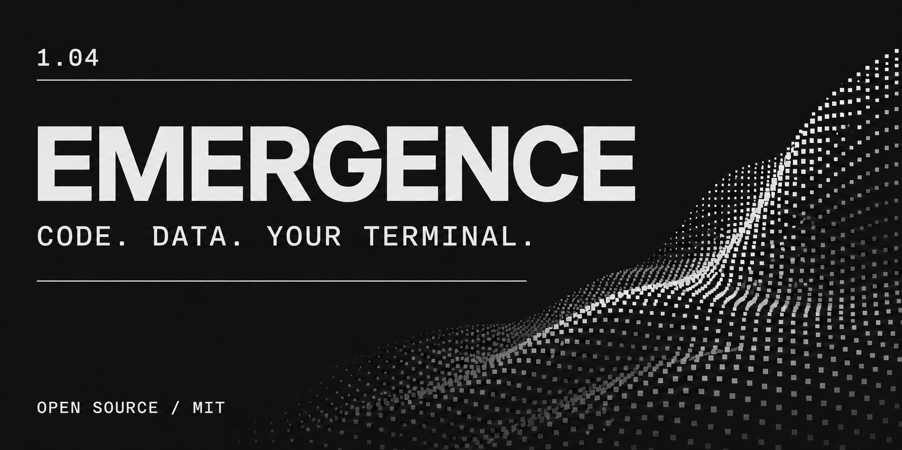

<p align="center"></p>
<h1 align="center">Emergence · 涌现</h1>
<p align="center"><strong>Turn ideas into code. Turn data into answers.</strong></p>
<p align="center">An open-source terminal agent for coding and data analysis, with an independent Harness, a Chinese-first TUI, and a native model configuration app.</p>
<p align="center"><a href="README.md">简体中文</a> · English</p>
<p align="center"><a href="https://github.com/shianlab/emergence/releases/tag/v1.0.4">Release 1.04</a> · <a href="LICENSE">MIT</a> · Windows x64 · <a href="https://github.com/shianlab/emergence/actions/workflows/ci.yml">CI</a></p>
<p align="center"><a href="#install">Install</a> · <a href="#a-terminal-workspace">Workspace</a> · <a href="#work-with-code-and-data">Examples</a> · <a href="#updates-and-maintenance">Updates</a> · <a href="#develop">Develop</a></p>

## Install

Run in **PowerShell on Windows x64**:

```powershell
irm https://raw.githubusercontent.com/shianlab/emergence/main/install.ps1 | iex
```

The installer verifies the signed release manifest and SHA-256, retries interrupted downloads, reuses verified downloads, and checks startup before activation. The release includes its own runtime and installs under your Windows user account. [Review the script](install.ps1) · [Manual and offline installation](docs/installation.md)

```powershell
cd "D:\my-project"
emergence --version
emergence
```

1. Enter `/model-config` to configure a provider, model, endpoint and API key. Test the connection and save. [Model configuration guide](docs/model-configuration.md)
2. Use `/model` to select it for the current pane. Check the project directory on the home screen.
3. Send a first task such as “Read this project and tell me how to start it and run its tests.” Type `/` to find commands. Use `Shift+Tab` to cycle permission modes, including Rage. Enter `/permission rage` to enable automatic tool approval for the current pane.

Windows 11 and Windows Terminal are recommended for the Windows x64 release. The native configuration tool requires .NET Framework 4.8. Supply your own model API credentials. The optional data analysis tools require CPython 3.14 x64.

## A terminal workspace


The frame uses demo configuration and a demo project path. The cover is generated brand artwork.

<details>
<summary>View the command menu</summary>


</details>

| Capability | What it provides |
| --- | --- |
| Coding | Project context, change planning, file edits, checks and execution evidence |
| Data analysis | Profiling, SQL and statistics over CSV/TSV/XLSX/Parquet, with charts and reproducible reports |
| Built-in KIM | Requirement intake, planning, governance roles, evidence and memory within the session runtime |
| Model choice | Configurable OpenAI Completions/Responses, Anthropic Messages and Google Generative AI protocols; gateway compatibility must be verified |
| Independent panes | Separate projects, models, drafts and conversations; user-directed tasks in each pane |
| Extensibility | `EMERGENCE.md`, Skills, MCP and local extensions |
| Execution visibility | Streaming replies, live status, tool details, keyboard approvals, cancellation and history |

Emergence Harness integrates the DeepSeek Harness execution foundation, OpenTUI, Meta_Kim-derived governance and specialized coding/data tools. It is an independent product; upstream attribution remains in [THIRD_PARTY_NOTICES.md](emergence/THIRD_PARTY_NOTICES.md).

## Work with code and data

```text
Understand the authentication flow and propose a fix before editing any files.
```

```text
Fix the boundary condition, run the relevant tests, and explain the verification results.
```

Use `/init` to preview `EMERGENCE.md`. Add your project's build commands, test entry points, and editing conventions so future sessions in that project can reuse them.

For data tools, install CPython 3.14 x64 and initialize the managed environment:

```powershell
emergence data-init --python "C:\Python314\python.exe"
```

Use the actual interpreter path. Dependencies are version-pinned and hash-checked. The environment is separate from application versions.

```text
Profile sales.csv, check missing values and outliers, compare monthly revenue, and produce a report with explicit assumptions.
```

Computation runs locally; task context and tool results may be sent to your configured model provider. Review that provider's data policy before processing sensitive data.

## Stay in control

Permissions: `plan` is read-only; `ask` requests approval for effects; `edit` allows ordinary in-project edits; `auto` allows explicitly configured execution scopes. Deny rules and mandatory approval still apply. These controls are not an OS sandbox. See [SECURITY.md](SECURITY.md).

Use `F2` / `F3` to split, `Tab` to switch and `F6` to close panes. **Panes are independent:** there is no master-pane control or cross-pane delegation. Coordinate simultaneous edits yourself, preferably with separate Git worktrees.

`Enter` sends, `Shift+Enter` inserts a newline. `/help` and `Ctrl+P` discover commands; `/sessions` opens history; `/init` prepares project instructions; `/skills`, `/mcp`, `/context` and `/doctor` inspect capabilities and runtime state. Restoring a session does not replay side effects.

Credentials use Windows DPAPI for the current user. Configuration and history default to `%USERPROFILE%\.emergence`. The CLI/TUI is Chinese-first and supports `/language en`; documentation and translation improvements are welcome.

## Updates and maintenance

Users on **1.00 or 1.01** can migrate with the installer above. Starting with **1.02**, open `/update` to check the stable channel and choose when to install, or run these commands from PowerShell. [Installation and proxy setup](docs/installation.md)

```powershell
emergence update --check
emergence update
emergence rollback
```

New windows use the update after the installer verifies it. Open windows can finish their current tasks. A healthy previous version is kept for rollback. Your configuration, keys, and sessions live separately from application versions. Release 1.04 adds Rage mode and includes it in the Shift+Tab permission cycle. [Release notes](docs/releases/1.0.4.md) · [Changelog](CHANGELOG.md)

## Develop

Use Git, Node **26.13.0**, npm, and the .NET Framework 4.8 compiler on Windows.

```powershell
git clone https://github.com/shianlab/emergence.git
cd emergence\emergence
npm ci
npm run build
npm start
```

Run `npm run check`, `npm test` and relevant integration checks. Data tests require the Python environment. See [CONTRIBUTING.md](CONTRIBUTING.md), [installation and upgrades](docs/installation.md), [release notes](docs/releases/1.0.4.md) and the [application manual](emergence/README.md).

## License and support

Own code is [MIT](LICENSE). Third-party code and derived assets retain their original licenses and notices. See [attributions](emergence/THIRD_PARTY_NOTICES.md).

Report reproducible bugs through [GitHub Issues](https://github.com/shianlab/emergence/issues), without keys or private project data. Follow the [security policy](SECURITY.md) for vulnerabilities. macOS, Linux and ARM64 are not released or certified in 1.04.
