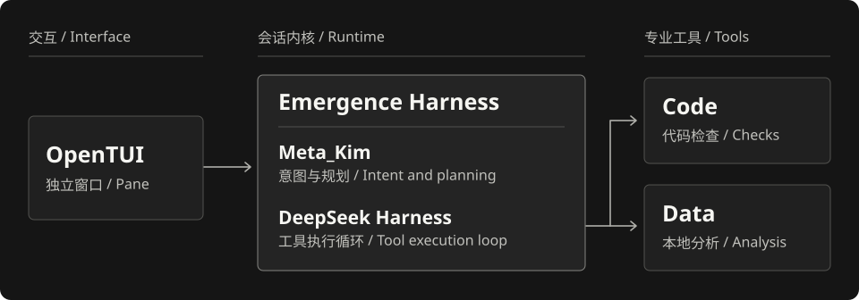
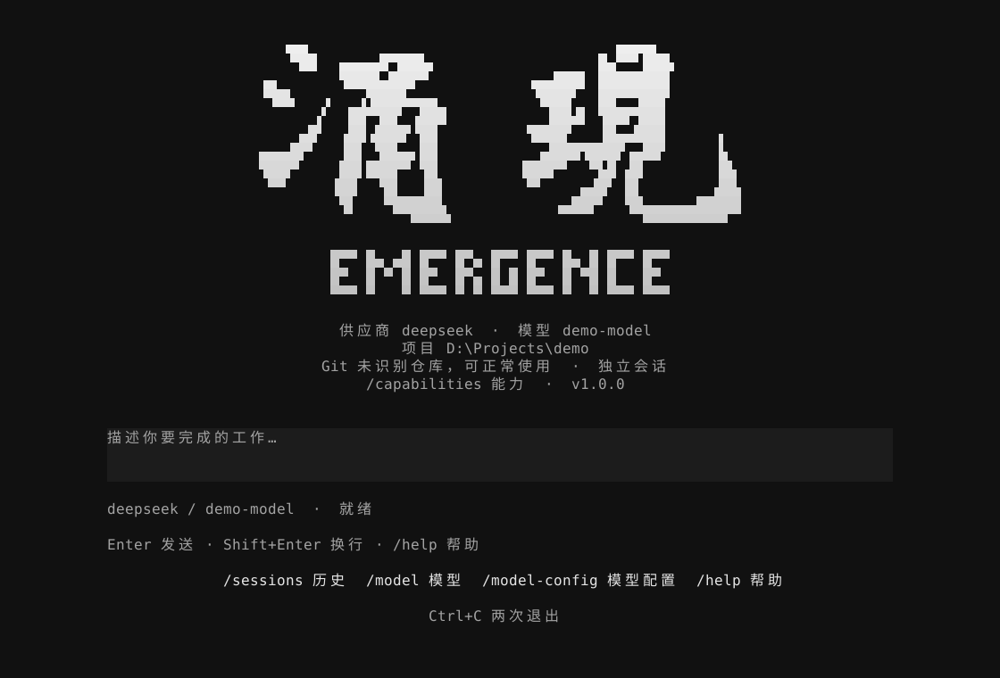
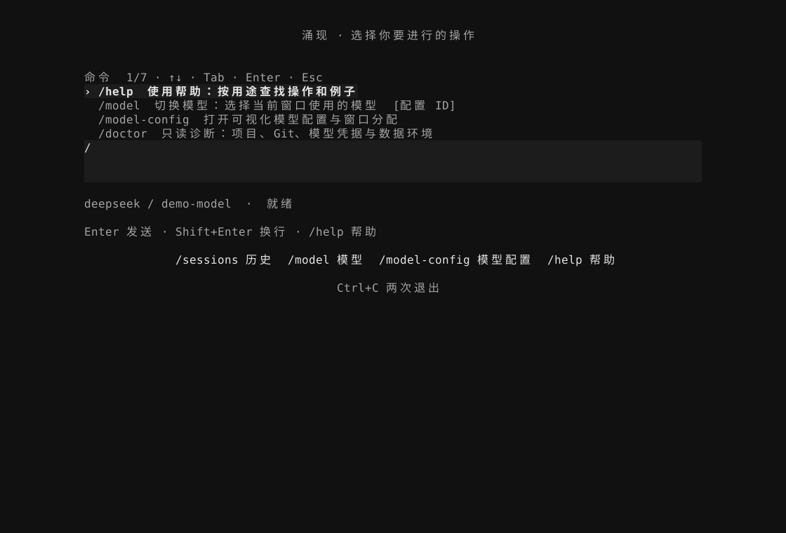

# Emergence · 涌现

**A Chinese-first terminal agent for code and data.** Trace a failed import to the line that broke, or trace a change in monthly revenue back to individual orders. Each pane has its own project, model and conversation.

[](https://github.com/shianlab/emergence/releases/tag/v1.0.8)
[](https://m8ven.ai/mcp/shianlab-emergence-xrt4o4?s=readme)

[Architecture](#architecture) · [Install](#install) · [Code and data](#work-with-code-and-data) · [Workspace](#a-terminal-workspace) · [简体中文](README.md)

## Architecture

**Emergence Harness** connects a terminal request to a result you can inspect. OpenTUI handles interaction. Built-in Meta_Kim interprets the request and plans the work. The DeepSeek Harness execution loop calls the selected model and tools. Code and Data run within that session and keep their own results.



| Request | Inside the session | Where to look |
| --- | --- | --- |
| Ask a question or describe a task | KIM selects a direct response, lightweight plan or structured plan with acceptance conditions. | Open `/plan` when a plan is available. |
| Change code and run the tests | The tool loop applies the pane’s permission rules. Code records changes and the checks that actually ran. | Use `/tasks` for progress and `/code` for the working directory, exit code and diagnostics. |
| Analyze a table | Data reads the local input and computes results using the agreed metric definitions. | Inspect the report and CSV breakdown, then recompute with the input snapshot and `replay.py`. |

A plan and its execution record are stored separately. For a request to fix an import, the plan describes the expected behavior. The test result carries the exit code from the command that ran. [Architecture and module ownership](docs/structure/README.md) · [Session and planning lifecycle](docs/structure/session-planning.md)

## Install

Run in **PowerShell on Windows x64**:

```powershell
irm https://raw.githubusercontent.com/shianlab/emergence/main/install.ps1 | iex
```

The installer verifies the signed release manifest and SHA-256, retries interrupted downloads, reuses verified downloads, and checks startup before activation. The release includes its own runtime and installs under your Windows user account. [Review the script](install.ps1) · [Manual and offline installation](docs/installation.md)

```powershell
cd "D:\my-project"
emergence --version
emergence
```

1. Enter `/model-config` to configure a provider, model, endpoint and API key. Test the connection and save. [Model configuration guide](docs/model-configuration.md)
2. Use `/model` to select it for the current pane. Check the project directory on the home screen.
3. Send a first task such as “Read this project and tell me how to start it and run its tests.” Type `/` to find commands. Use `Shift+Tab` to choose how the current pane handles approvals.

Windows 11 and Windows Terminal are recommended for the Windows x64 release. The native configuration tool requires .NET Framework 4.8. Supply your own model API credentials. The optional data analysis tools require CPython 3.14 x64.

## Work with code and data

### Investigate an empty-file import

Start in **Plan** mode to locate the failure. For example, ask:

> Trace an empty file from the file picker through the first row of the parser. Show where the failure happens and which tests cover that path.

After reviewing the plan, switch to **Auto edit** and ask for the change:

> Return “No data to import” for an empty file. Preserve the existing behavior for populated files. Add tests for both cases and run the relevant checks.

Use `/plan` to inspect the acceptance conditions and `/tasks` to see execution progress. Open `/code` to check the working directory, exit code, diagnostics and changed files. Put recurring build commands and editing conventions in `EMERGENCE.md`. Use `/init` to preview it.

### Explain a change in monthly revenue

Install CPython 3.14 x64 and initialize the data environment with the path to your interpreter:

```powershell
emergence data-init --python "C:\Python314\python.exe"
```

> Read orders.csv. Check for duplicate order IDs and missing dates or amounts. Group paid amounts by payment month and channel, account for refunds separately, and show each channel’s contribution to the month-over-month change. Ask about missing fields before calculating.

The native analysis tools work with local CSV, TSV, XLSX and Parquet files. Read the input-quality section before interpreting the totals. Check the CSV breakdown against the report, export the SVG chart, or use the input snapshot and `replay.py` to recompute the result. Artifacts are stored under `core/data-runs/<run ID>/` in the configuration directory.

The native analysis limits are 8 MiB of input, 10,000 rows, 128 columns and 100,000 cells. Computation runs locally. Your model provider may receive conversation context and tool results. [Methods and scope](docs/code-data-phase5-report.md)

## A terminal workspace



The frame uses demo configuration and a demo project path.

<details>
<summary>View the command menu</summary>



</details>

Each pane keeps its own project, model, draft and conversation. For example, use one pane to fix an importer and another to examine the source data.

| Action | Shortcut or command |
| --- | --- |
| Split side by side or stack panes | `F2` / `F3` |
| Switch or close the active pane | `Tab` / `F6` |
| Choose a permission mode | `Shift+Tab` / `/permission` |
| Resume the workspace or browse sessions | `/continue` / `/sessions` |
| Show keybindings or help | `/keys` / `/help` |

## Stay in control

Permissions: `plan` is read-only; `ask` requests approval for effects; `edit` allows ordinary in-project edits; `auto` allows explicitly configured execution scopes. Auto mode respects deny rules and mandatory approval. Rage mode auto-approves tool calls in the current pane, including shell commands, out-of-project file operations and MCP tools. OS permissions and task-level read-only restrictions still apply. These controls are not an OS sandbox. See [SECURITY.md](SECURITY.md).

Model profiles support the OpenAI Completions and Responses, Anthropic Messages, and Google Generative AI protocols. Select the active model with `/model`. Keep project instructions in `EMERGENCE.md` and inspect the session’s tools with `/capabilities`.

`Enter` sends, `Shift+Enter` inserts a newline. `/help` and `Ctrl+P` discover commands; `/sessions` opens history; `/init` prepares project instructions; `/skills`, `/mcp`, `/context` and `/doctor` inspect capabilities and runtime state. Restoring a session does not replay side effects.

Credentials use Windows DPAPI for the current user. Configuration and history default to `%USERPROFILE%\.emergence`. The CLI/TUI is Chinese-first and supports `/language en`; documentation and translation improvements are welcome.

## Updates and maintenance

Users on **1.00 or 1.01** can migrate with the installer above. Starting with **1.02**, open `/update` to check the stable channel and choose when to install, or run these commands from PowerShell. [Installation and proxy setup](docs/installation.md)

```powershell
emergence update --check
emergence update
emergence rollback
```

New windows use the update after the installer verifies it. Open windows can finish their current tasks. The installer keeps a healthy previous version for rollback. Configuration, keys, and sessions live separately from application versions. Release 1.08 adds an official fallback for update checks and fixes installer maintenance from PowerShell 7. [Release notes](docs/releases/1.0.8.md) · [Changelog](CHANGELOG.md)

## Develop

Use Git, Node **26.13.0**, npm, and the .NET Framework 4.8 compiler on Windows.

```powershell
git clone https://github.com/shianlab/emergence.git
cd emergence\emergence
npm ci
npm run build
npm start
```

Run `npm run check`, `npm test` and relevant integration checks. Data tests require the Python environment. See [CONTRIBUTING.md](CONTRIBUTING.md), [installation and upgrades](docs/installation.md), [release notes](docs/releases/1.0.8.md) and the [application manual](emergence/README.md).

## License and support

Own code is [MIT](LICENSE). Third-party code and derived assets retain their original licenses and notices. See [attributions](emergence/THIRD_PARTY_NOTICES.md).

Report reproducible bugs through [GitHub Issues](https://github.com/shianlab/emergence/issues), without keys or private project data. Follow the [security policy](SECURITY.md) for vulnerabilities. The official 1.08 package targets Windows x64.
