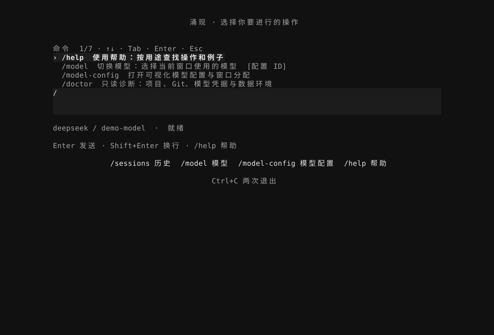

<h1 align="center">涌现 · Emergence</h1>
<p align="center"><strong>在终端里，把想法变成代码，把数据变成答案。</strong></p>
<p align="center">面向编程与数据分析的开源 CLI Agent，拥有独立 Harness、中文 TUI 和原生模型配置工具。</p>

<p align="center">
  <a href="https://github.com/shianlab/emergence/releases/tag/v1.0.8"></a>
  <a href="LICENSE"></a>
  <a href="docs/installation.md"></a>
  <a href="https://github.com/shianlab/emergence/actions/workflows/ci.yml"></a>
</p>

<p align="center">简体中文 · <a href="README.en.md">English</a></p>
<p align="center"><a href="#快速开始">快速开始</a> · <a href="#界面一览">界面</a> · <a href="#能做什么">能力</a> · <a href="#更新与维护">更新与维护</a> · <a href="CONTRIBUTING.md">参与开发</a></p>

---

Emergence 把任务理解、上下文、工具执行、权限和结果记录连成一个工作流。你可以在项目目录里读代码、修改文件、运行检查，也可以分析本地数据并生成报告。模型由你选择，工作过程在终端中可见。

**Emergence Harness** 基于 DeepSeek Harness 的执行底座，结合 OpenTUI、内置 Meta_Kim 治理流程及代码/数据工具构建。它是一套独立产品；底座归属与第三方许可证保留在[来源声明](emergence/THIRD_PARTY_NOTICES.md)。

## 快速开始

在 **Windows x64 的 PowerShell** 中复制执行：

```powershell
irm https://raw.githubusercontent.com/shianlab/emergence/main/install.ps1 | iex
```

发行包自带运行环境，**无需管理员权限或预装 Node.js、npm**。安装器校验签名及 SHA-256，支持下载重试和缓存复用，在验证程序能启动后切换入口。执行前可查看 [安装脚本](install.ps1) 或选择 [手动安装与离线安装](docs/installation.md)。

进入项目目录，启动：

```powershell
cd "D:\my-project"
emergence --version
emergence
```

1. 输入 `/model-config`，在原生配置窗口添加供应商、模型、API 地址和密钥，测试连接并保存。[模型配置指南](docs/model-configuration.md)
2. 输入 `/model`，为当前窗口选择刚保存的模型。确认首页显示的是你的项目目录。
3. 发送第一条任务，比如「先读一下这个项目，告诉我它怎么启动、测试从哪里跑」。输入 `/` 搜索中文命令，用 `Shift+Tab` 切换执行权限。`/permission rage` 让当前窗口自动批准工具调用。

> 发行包支持 Windows x64，推荐 Windows 11 + Windows Terminal。原生模型配置需要 .NET Framework 4.8，模型服务使用你自己的 API 凭据。只有数据分析工具需要单独准备 CPython 3.14 x64。

## 界面一览


<p align="center"><sub>由当前 TUI 渲染器导出的首页帧，使用演示模型与项目路径。</sub></p>

<details>
<summary>展开查看中文斜杠命令引导</summary>



</details>

## 能做什么

| 能力 | 工作方式 |
| --- | --- |
| **编程** | 理解项目和代码上下文，规划变更，编辑文件，运行检查，并记录执行与验证结果 |
| **数据分析** | 对 CSV、TSV、XLSX、Parquet 进行画像、查询和统计分析，生成图表、报告与重算材料 |
| **内置 KIM** | 在会话执行链中承接需求理解、计划、治理角色、证据和记忆；不需要先安装一份外部 Skill |
| **多模型** | 按模型档案配置 OpenAI Completions/Responses、Anthropic Messages、Google Generative AI 协议；网关需兼容所选协议 |
| **独立分屏** | 每个窗口独立选择项目、模型和任务，保留自己的草稿、对话与权限状态 |
| **可扩展上下文** | 项目规则 `EMERGENCE.md`、Skills、MCP 和本地扩展接入同一工作台 |
| **可见的执行过程** | 流式回复、状态反馈、工具详情、键盘审批、取消与会话历史 |

### 在现有项目里改代码

```text
先分析这个项目的登录流程，给出修改方案，暂时不要改文件。
```

```text
修复这个边界条件，并运行与改动相关的测试，说明验证结果。
```

计划、工具回执和验证结果保留在会话中。模型的总结不替代实际执行记录；执行工具仍受当前窗口的权限规则约束。

经常需要遵守的项目约定可以写进 `EMERGENCE.md`。用 `/init` 预览项目规则文件，把构建命令、测试入口和修改范围写在里面，方便以后在同一项目继续工作。

### 分析数据并生成报告

安装 CPython 3.14 x64 后，在终端执行一次：

```powershell
emergence data-init --python "C:\Python314\python.exe"
```

将路径替换为你的 Python 解释器。应用会建立独立环境，按固定版本和 SHA-256 安装 DuckDB、openpyxl、SciPy、NumPy 等依赖。数据环境与应用版本分离，升级应用可以复用兼容环境。

```text
分析 sales.csv：先检查字段、缺失值和异常值，再比较各月收入，生成报告并注明口径。
```

计算在本机进行；模型可能接收任务需要的上下文和工具结果。涉及敏感数据时，请先确认所选模型服务的数据政策。

### 多个窗口，各自专注

`F2` 左右分屏，`F3` 上下分屏，`Tab` 切换，`F6` 关闭。窗口可以使用同一项目，也可以使用不同项目和模型。

各窗口独立接收任务，分别保有目录、模型和会话。同一项目中的并行编辑需自行协调。需要隔离修改时可使用 Git worktree。

## 你掌握执行权限

| 模式 | 行为 |
| --- | --- |
| `plan` · 计划 | 只读分析，阻止写入和执行 |
| `ask` · 询问 | 读取可直接进行，有副作用的操作按规则确认 |
| `edit` · 自动编辑 | 允许项目内普通文件编辑，命令和项目外操作继续确认 |
| `auto` · 自动执行 | 自动执行显式允许范围内的操作；拒绝规则和强制审批继续生效 |

`Shift+Tab` 或 `/permissions` 切换。审批通过方向键选择、Enter 确认、Esc 取消。权限控制不等同于系统沙箱，详见 [SECURITY.md](SECURITY.md)。

## 常用入口

| 命令 / 快捷键 | 用途 |
| --- | --- |
| `/`、`/help`、`Ctrl+P` | 中文命令引导、帮助与搜索 |
| `/model`、`/model-config` | 选择模型、打开原生配置工具 |
| `/continue`、`/sessions` | 继续工作台、查看历史会话 |
| `/init` | 预览并创建项目规则 `EMERGENCE.md` |
| `/skills`、`/mcp` | 查看已发现的技能与 MCP 服务 |
| `/context`、`/permissions` | 查看上下文和执行权限 |
| `/code`、`/doctor` | 编程回执、运行环境诊断 |
| `/update` | 检查稳定版、查看说明、选择更新 |
| `Enter`、`Shift+Enter` | 发送、换行 |
| `Ctrl+C` | 清空草稿或停止；空闲时连续两次退出 |

配置默认保存在 `%USERPROFILE%\.emergence`，API 密钥使用当前 Windows 用户的 DPAPI 加密。恢复历史不会自动重放执行操作。高级配置见[应用手册](emergence/README.md)。

## 更新与维护

**1.00 / 1.01** 用户先用上方安装命令迁移一次。**1.02 及以后**可通过 `/update` 或下面的命令检查和安装。自定义安装目录、离线维护与代理设置见 [安装与升级指南](docs/installation.md)。

```powershell
emergence update --check
emergence update
emergence rollback
```

更新会先验证新版本，再让新启动的窗口使用它。已打开的窗口可继续当前任务。安装器保留可用的上一版本用于回退，配置、密钥和会话由独立的用户目录保存。1.08 为版本检查增加官方备用入口，修复 PowerShell 7 下的安装维护。[1.08 发布说明](docs/releases/1.0.8.md) · [更新日志](CHANGELOG.md)

## 从源码开发

需要 Git、Node **26.13.0** 与 npm；构建原生配置工具还需要 .NET Framework 4.8 编译器。

```powershell
git clone https://github.com/shianlab/emergence.git
cd emergence\emergence
npm ci
npm run build
npm start
```

```powershell
npm run check          # 类型、排版、架构边界
npm test               # 确定性回归；数据测试需要 Python 环境
npm run inspect:full   # Harness、TUI、ConPTY 完整本机矩阵
```

架构按 `app`、`core/domain`、`core/application`、`core/adapters`、`core/storage`、`domains/code` 与 `domains/data` 分层。开发约定和验证入口见 [CONTRIBUTING.md](CONTRIBUTING.md)。

## 版本与支持

- **1.08** 支持 Windows x64，包含凭据隔离、任务与更新恢复、终端空闲优化及 Windows 更新兼容性修正。
- 下载、校验、更新、卸载与故障排查：[安装指南](docs/installation.md)。
- 变更与已知限制见 [CHANGELOG.md](CHANGELOG.md) · [1.08 发布说明](docs/releases/1.0.8.md)。
- 问题反馈：[GitHub Issues](https://github.com/shianlab/emergence/issues)；安全问题请使用[私密报告流程](SECURITY.md)。

欢迎复现问题、改进文档和提交聚焦的 PR。请勿把 API 密钥、真实会话或私有项目内容附到公开 issue 中。

## 许可与致谢

自有代码采用 [MIT](LICENSE)。感谢 DeepSeek Harness、OpenTUI 与 Meta_Kim 等开源项目。第三方组件与派生资料继续遵循各自许可，完整来源见 [THIRD_PARTY_NOTICES.md](emergence/THIRD_PARTY_NOTICES.md)。
