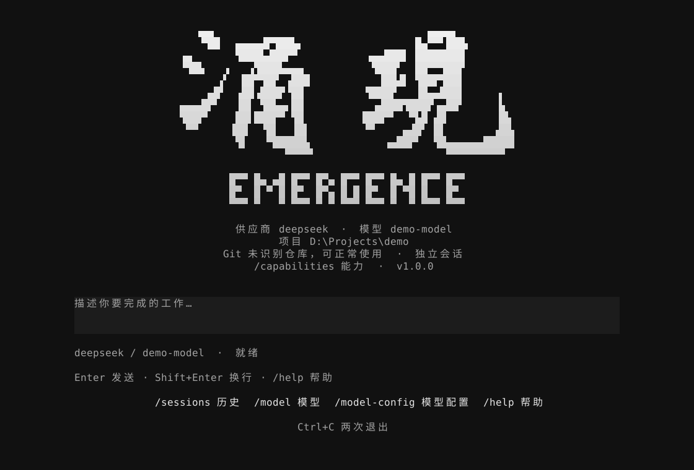

# 涌现 · Emergence

**一个在项目目录里工作的中文终端 Agent，面向编程与数据分析。**

给涌现一个仓库，它可以沿调用链查找问题、修改代码，再运行项目的测试。给它一份订单表，它可以先和你确定销售额的口径，再交付图表、明细和复算脚本。你选择模型，在同一个终端查看它读了哪些文件、执行了哪些操作，以及结果如何验证。

[正式版 **1.08**](https://github.com/shianlab/emergence/releases/tag/v1.0.8) · Windows x64 · [MIT](LICENSE) · [English](README.en.md)

[快速开始](#快速开始)　/　[编程工作流](#编程工作流)　/　[数据分析](#数据分析)　/　[终端工作台](#终端工作台)　/　[权限与扩展](#权限与扩展)　/　[更新与维护](#更新与维护)

## 快速开始

在 Windows x64 的 PowerShell 中安装。发行包自带 Node.js 运行环境，按当前用户安装。

```powershell
irm https://raw.githubusercontent.com/shianlab/emergence/main/install.ps1 | iex
```

在**你的项目目录**打开终端，输入以下命令启动工作台。

```powershell
emergence
```

首次使用时，输入 `/model-config` 打开 Windows 原生配置窗口，填写模型服务地址、模型 ID 和自己的 API 密钥，测试连接后保存。回到终端，用 `/model` 选中该模型。首页会显示本次会话的工作目录和模型。[模型配置指南](docs/model-configuration.md)

**第一条任务可以很小。** 在熟悉的仓库试试下面这句，你可以对照文件路径判断涌现有没有读懂项目。

> 找到这个项目的启动入口和测试命令，分别告诉我依据在哪个文件。先只读，不改代码。

推荐使用 Windows 11 和 Windows Terminal。模型配置窗口需要 .NET Framework 4.8。本地数据分析还需准备 CPython 3.14 x64。需要先检查安装脚本或在离线电脑部署时，可使用独立发行包。[查看安装脚本](install.ps1) · [手动与离线安装](docs/installation.md)

## 编程工作流

假设导入功能在空文件上报错。可以先用 `Shift+Tab` 切到**计划**模式，让涌现定位问题。

> 跟踪从选择文件到解析第一行的调用链。找出空文件触发异常的位置，列出受影响的入口和现有测试。

看过方案后，切到**自动编辑**，再给出验收条件。

> 空文件应返回“没有可导入的数据”。保留正常文件的行为，补上覆盖两个分支的测试，运行相关检查。

| 想确认什么 | 去哪里看 |
| --- | --- |
| 它准备改哪些地方，怎样算完成 | `/plan` 查看本次方案、缺口和验收条件 |
| 哪些步骤真的开始或结束了 | `/tasks` 查看当前会话的任务记录 |
| 测试究竟跑在哪个目录，结果怎样 | `/code` 查看实际命令的执行目录、退出码、诊断和本轮变更 |
| 如何评估一次恢复操作 | `/code preview "文件路径"` 预览恢复，再决定是否执行 |

项目有固定的包管理器、构建顺序或生成目录时，可以把这些约定写进 `EMERGENCE.md`。输入 `/init` 先预览，让下一次进入这个仓库的会话也能读到同一套规则。[编程与项目指引手册](emergence/README.md)

## 数据分析

涌现支持对本地 CSV、TSV、XLSX 和 Parquet 做数据画像、只读查询和统计分析。首次启用时，将下面的路径替换为本机 **Python 3.14 x64** 解释器的实际位置。初始化会建立独立环境，并按锁定版本和哈希安装分析依赖。

```powershell
emergence data-init --python "C:\Python314\python.exe"
```

**示例任务 · 上个月的销售额为什么下降？** 把问题和项目内的数据文件一起交给涌现。下面是假设订单表包含相应字段时可以直接改写的提问。

> 读取 orders.csv，先检查订单号是否重复、日期和金额是否缺失。按支付月和渠道汇总实付金额，以元为单位。单列退款，给出各渠道对环比变化的贡献。缺失字段先问我，最后导出月度明细和图表。

阅读结果时，先看报告里的**输入质量与范围**，再看业务结论。按支付月还是下单月分组、退款归属哪个月，都可能改变答案。确认后的计算口径与结果一起保存，便于后来的人重算。

| 交付物 | 怎么用 |
| --- | --- |
| 中文 HTML 报告 | 阅读分析范围、计算口径、结果与图表 |
| CSV 明细与 SVG 图表 | 逐项核对数字，或将图表放入自己的报告 |
| 输入快照、计算记录与 `replay.py` | 在具备对应依赖的 Python 环境中重算，再与原结果比较 |

分析产物位于配置目录的 `core/data-runs/<运行 ID>/`。当前原生分析限制为 8 MiB 输入、1 万行、128 列、10 万个单元格。计算在本机运行，会话上下文和工具结果可能发送到你选择的模型服务。[分析方法与适用范围](docs/code-data-phase5-report.md)

## 终端工作台



*首页示例取自 OpenTUI 渲染帧，使用演示模型和目录。*

首页提交第一条任务后进入对话。输入 `/` 可筛选命令，`Ctrl+P` 打开命令面板，`Enter` 发送，`Shift+Enter` 换行。工具调用、审批和模型回复都能在会话中查看。

<details>
<summary>查看中文命令菜单</summary>


</details>

**独立分屏**适合把几件事并排做。比如左边在应用仓库修导入逻辑，右边在数据目录核对样本。每个窗口单独选择目录和模型，各自保存草稿、任务和对话。对同一仓库并行改代码时，可以用 Git worktree 隔离修改。

| 操作 | 快捷键或命令 |
| --- | --- |
| 左右分屏 / 上下分屏 | `F2` / `F3` |
| 切换 / 关闭当前窗口 | `Tab` / `F6` |
| 切换当前窗口的权限 | `Shift+Tab` |
| 继续上次工作台 / 打开历史会话 | `/continue` / `/sessions` |
| 查看实际键位 / 获取帮助 | `/keys` / `/help` |

## 权限与扩展

`Shift+Tab` 在五种权限模式间循环。`/permission` 可直接选择模式。审批时用方向键选择，回车确认，Esc 取消。

| 模式 | 适合的工作 |
| --- | --- |
| 计划 · `plan` | 探索仓库、讨论方案、做只读分析 |
| 询问 · `ask` | 逐项审阅有副作用的工具操作 |
| 自动编辑 · `edit` | 允许常规项目内编辑，按规则确认命令和越界操作 |
| 自动执行 · `auto` | 在已配置的允许范围内执行，保留拒绝规则和强制审批 |
| 狂暴模式 · `rage` | 当前窗口自动批准工具调用，覆盖窗口的允许、询问与拒绝规则。Shell、项目外文件和 MCP 都可能直接执行 |

狂暴模式仍受操作系统权限、运行时校验和任务只读约束。API 密钥使用当前 Windows 用户的 DPAPI 加密。配置和会话默认保存在 `%USERPROFILE%\.emergence`。[安全说明](SECURITY.md)

### Emergence Harness 如何组织一次任务

- **理解任务。** 内置 Meta_Kim 根据请求选择直接处理、轻量规划或结构化规划。复杂任务可以先明确输入、所需能力和验收条件，输入 `/plan` 可查看。
- **执行与记录。** Emergence Harness 调用当前会话的模型和工具，处理权限、取消与任务收尾。工作台把规划、工具回执和执行结果展示给你。
- **接入自己的环境。** 模型档案支持 OpenAI Completions / Responses、Anthropic Messages 和 Google Generative AI 协议。用 `/skills` 查看发现的技能，`/mcp` 查看外部服务，`/capabilities` 查看当前会话可用的能力。

Emergence Harness 基于 DeepSeek Harness 的执行底座，结合 OpenTUI、内置 Meta_Kim 和编程、数据分析模块。各组件的来源与许可可在仓库中查阅。[架构维护说明](docs/structure/README.md) · [第三方声明](emergence/THIRD_PARTY_NOTICES.md)

## 更新与维护

本次正式版 **1.08** 的程序版本为 **`1.0.8`**。这一版在 GitHub Raw 连接失败时可通过 GitHub API 检查签名清单，并修复了从 PowerShell 7 执行离线升级、回退和维护时的模块查找问题。[1.08 发布说明](docs/releases/1.0.8.md) · [完整更新日志](CHANGELOG.md)

```powershell
emergence --version       # 查看本机版本
emergence update --check  # 只检查官方稳定版
emergence update          # 下载、校验并启用更新
```

也可以在终端界面输入 `/update`。安装器会校验签名清单和发行包，验证程序能够启动后切换版本。需要回到上一个可用版本时，运行 `emergence rollback`。1.00 和 1.01 用户可用本文开头的安装命令迁移。[安装、回退与故障排查](docs/installation.md)

## 从源码开发

需要 Git、Node **26.13.0** 与 npm；构建原生配置工具还需要 .NET Framework 4.8 编译器。

```powershell
git clone https://github.com/shianlab/emergence.git
cd emergence\emergence
npm ci
npm run build
npm start
```

```powershell
npm run check          # 类型、排版、架构边界
npm test               # 确定性回归；数据测试需要 Python 环境
npm run inspect:full   # Harness、TUI、ConPTY 完整本机矩阵
```

架构按 `app`、`core/domain`、`core/application`、`core/adapters`、`core/storage`、`domains/code` 与 `domains/data` 分层。开发约定和验证入口见 [CONTRIBUTING.md](CONTRIBUTING.md)。

欢迎通过 [GitHub Issues](https://github.com/shianlab/emergence/issues) 提交可复现的问题。安全问题请使用[私密报告流程](SECURITY.md)。

## 第三方评测

[](https://m8ven.ai/mcp/shianlab-emergence-xrt4o4?s=readme)

查看 M8ven 对仓库源码的评测记录与发布者验证状态。

## 许可与致谢

自有代码采用 [MIT](LICENSE)。感谢 DeepSeek Harness、OpenTUI 与 Meta_Kim 等开源项目。第三方组件与派生资料继续遵循各自许可，完整来源见 [THIRD_PARTY_NOTICES.md](emergence/THIRD_PARTY_NOTICES.md)。
