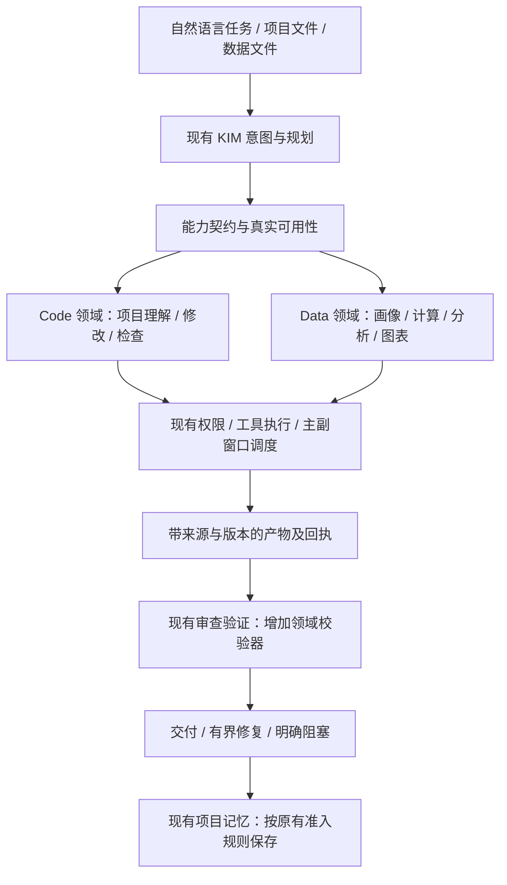

# Emergence 原生编程与数据分析能力增强方案

日期：2026-10-30；状态更新于 2026-10-31。第一至第三阶段已实施并完成巡检，见 [第一阶段交付报告](code-data-phase1-report.md)、[第二阶段交付报告](code-data-phase2-report.md) 和 [第三阶段交付报告](code-data-phase3-report.md)；第四阶段本机数据接入与执行基础已交付，专用远程数据源仍待接入与验收，见 [第四阶段报告](code-data-phase4-report.md)；第五阶段已实施，见 [第五阶段报告](code-data-phase5-report.md)；第六阶段工程联调与本机巡检已完成，见 [第六阶段报告](code-data-phase6-report.md)。全量 37 项检查通过，最终性能增量的 215 项单元/集成、定向回归、安全与五分钟稳定性通过；实网保留原题 Code 3/3、脚本型 Data 1/3、原生数据完整交付 2/3 的实际结果，不标为全部模型任务稳定成功。下文仍保留原始设计目标，实际已交付范围和未完成项以各阶段报告为准。参考研究见 [六个仓库研究记录](research/2026-10-30-code-data-reference-review.md)。

## 目标与建设顺序

继续以 Emergence Harness 为产品核心，以已接入的 KIM 负责意图、规划、派工、审查与验证，在同一条执行链上增加原生 Code 和 Data 能力。用户仍然自然语言布置任务，系统自动选择必要方法与工具；不要求用户先记住 Skill 名称或输入启用命令。

修订为 **6 个实施阶段**：共同基础与基线 → 编程项目理解 → 编程修改验证 → 数据执行基础 → 数据分析交付 → 跨领域联调与统一验收。

按照用户反馈，先连续完成编程增强，再连续完成数据增强，最后统一验收。旧版交错安排原本兼顾底层依赖和数据能力尽早交付，但不利于按完整能力块推进，现由本顺序替代。

| 能力块 | 阶段 | 完成标志 |
|---|---|---|
| 共同基础 | 1 | 新能力接入同一权限、证据与 KIM 体系，建立评测基线 |
| 编程增强 | 2–3 | 能理解项目、修改代码、检查修复并交付；完成编程专项验收 |
| 数据增强 | 4–5 | 能读入数据、实际计算、核对口径并交付可复现报告；完成数据专项验收 |
| 整体交付 | 6 | 编程与数据混合任务、多窗口、性能和安全综合通过 |

KIM 接入贯穿各阶段：能力做出来就能自动使用，编程协作在第三阶段验收，数据协作在第五阶段验收。最终联调不替代阶段测试；每阶段仍完成巡检后汇报。

范围先按当前 Windows 本机工作方式设计：编程重点 TypeScript/JavaScript、Python、SQL；数据重点 CSV、XLSX、Parquet、本地 SQL，之后对实际业务需要的远程数据源增加连接适配。其他语言继续使用通用工具，明确是否具备专门验证。编程依赖在第二、三阶段、数据依赖在第四、五阶段实测后锁定，第一阶段先固定现状基线。

不改变已定稿 TUI 与原生模型配置工具，不重新选一套 Harness，也不另外启动 KIM、MiMo、Kimi 三套调度器。外部 Skills/MCP 保留扩展能力；核心领域方法随 Emergence 提供，默认可发现，按任务加载必要部分。

## 对参考项目的取舍

| 来源 | 重点吸收 | 不直接照搬 |
|---|---|---|
| Kimi Code | 运行生命周期、工具按需加载、上下文恢复指针、子任务取消与部分输出 | 整个 Agent 主循环、固定 token 预算、整套依赖注入框架 |
| OpenCode | 工具契约、修改锁、分页输出、诊断和快照接口的分层思路 | dev 分支尚未接通的功能，以及全语言 LSP 常驻 |
| MiMo Code | 预算化检查点、子任务进展合并、Notebook 单元定位 | 独立 Compose 编排、并行维护第二份任务事实与长期记忆 |
| Claude Code | 公开的生命周期扩展、交互与验证流程 | 未公开的核心实现；不把公开仓库误当可任意复制的完整开源核心 |
| Data Analytics Skills | 31 个方法覆盖的业务流程、输入要求、产物结构和复核维度 | 有固定演示入口、口径遗漏、统计参数问题的脚本 |
| Knowledge Work / data | 问题分级、企业口径、SQL 方言、图表与验证流程 | 未配置的 MCP 占位符、整个业务插件目录和固定视觉样式 |

“内置”的验收含义是：在实际运行中自动识别任务，发现真实可用工具，调用成功，记录结果和依据，出错能修复或准确说明阻塞；不是向系统提示词添加“擅长数据分析”。

## 统一架构与职责

新增领域模块负责“如何理解和验证这个领域的工作”，原有系统继续负责“谁可以执行、在哪里执行、何时完成”。Python/SQL 进程可以有自己的运行生命周期，但不能拥有独立的派工权限或自动绕过审批。

建议以少量明确边界组织实现，文件名最终按现有代码风格确定：

| 位置/责任 | 设计增量 |
|---|---|
| `src/core/domain` | 能力、输入资源、运行结果、产物证据的类型与版本；兼容现有 schema |
| `src/core/adapters/planning.ts` | 增加 code/data/mixed 意图、证据要求和领域步骤；继续使用同一计划 |
| `src/domains/code`（拟新增） | 项目画像、上下文检索、变更与检查适配，不拥有通用执行循环 |
| `src/domains/data`（拟新增） | 文件/表画像、受管执行、指标与分析方法、报告产物 |
| 现有 `permissions` / `assurance` / `work-allocation` | 消费宿主能力描述，覆盖新工具的审批、证据与资源冲突 |
| 现有日志和记忆存储 | 存领域记录引用与版本；大表、图像、日志正文保存在任务产物目录 |
| 现有 TUI 消息与任务详情 | 展示简短真实阶段、产物入口与验证结论，不再堆默认展开的内部上下文 |

不要先造通用插件平台或一次性大重构。每次迁移一个现有分类入口，同时保留旧工具行为的回归检查。

## 第一阶段：能力契约、差距验证与评测基线

**交付目的：让后续 Code/Data 工具真正接入现有 Harness，而不是形成旁路。**

1. 固定当前版本的代表任务基线与测试环境：记录模型 ID、参数、任务预算、运行环境、通过/失败理由；确定目前通用工具能做到什么。
2. 给宿主内置能力增加可信描述：输入类型、输出类型、资源读写范围、网络/数据库副作用、取消、资源预算、证据类型。外部工具声明只作为信息，权限仍由宿主决定。
3. 修正适配假设：回执不能仅因 `emergence_` 前缀就跳过；权限、规划和调度也不能仅靠工具名字猜读写性质。控制工具不生成自证证据，领域执行工具必须留真实回执。
4. 扩展现有证据类型，形成最小产物清单：任务/运行 ID、输入资源版本、脚本或查询哈希、参数、运行环境、退出状态、结果路径、校验结果。文件 hash 已有则复用；不再建一个重复任务数据库。
5. 新字段版本化迁移；旧会话、旧任务、用户配置可继续加载，缺失字段表示未知。

**验收：** 新工具成功/失败/取消都有正确回执；plan/ask/edit/auto 模式的原有边界不变；伪造只读声明不能获得写权限；过期输入不能沿用旧验证；基线报告写明尚未测的能力。此阶段不以一张“已安装能力表”验收。

## 第二阶段：编程项目理解与上下文增强

**交付目的：先让 Agent 更准确地了解项目、定位代码，给下一阶段的修改与验证提供可靠依据。**

1. 项目画像：识别语言、项目根、包管理器、锁文件、工作区、入口、构建与测试配置；读取项目指引，标记已有未提交改动。
2. 项目检索：从 rg/文件结构开始，增加 TS/JS、Python 的符号、定义、引用线索及依赖关系。索引带文件版本，按需更新；不能把关键字匹配展示成完整语义分析。
3. 上下文选择：围绕当前问题提供相关代码、调用方、测试与约束，保留原文件与行号定位，避免每轮重复加载整个仓库。
4. 长任务恢复：在现有压缩与记忆机制中保留项目理解、当前目标、未解决问题、关键文件版本和证据指针；项目切换后不可沿用另一项目的事实。
5. TS/JS 与 Python 的 LSP/语言服务做按需适配；缺失或启动失败时使用文本检索与可执行检查降级。不能仅凭服务进程存活就显示“语义能力已验证”。
6. 自动接入现有 KIM：收到编程任务即可选择必要的探索能力；简单问答保持轻量，不要求手动加载 Skill。

**验收：** 能在代表项目中定位目标实现、关联调用方和测试；文件变化使旧索引失效；跨项目不串上下文；大仓库检索遵守输出和上下文预算；压缩后继续任务仍可找回证据。该阶段验收的是“理解与定位”，完整修改交付在第三阶段验收。

**用户可见变化：** “这个问题该改哪里”能得到有源码依据的定位，减少盲目扫目录、读错文件和反复重新理解项目。

## 第三阶段：编程修改、验证与协作闭环

**交付目的：减少找错文件、遗漏调用方、只写不测和反复无效修补。**

1. 使用第二阶段的项目画像与检索结果，定位改动范围及关联调用方；执行前检查画像和文件版本是否仍有效。
2. 复现问题并记录修改前的检查结果，区分本次引入的问题与项目已有失败；不能为了让检查变绿随意降低标准。
3. 检查适配器：绑定实际项目的 typecheck/lint/test，标准化错误的文件、行号、消息、执行版本和退出码。运行项目脚本仍遵守原权限，不因叫 test 就默认无副作用。
4. 修改前核对读到的版本，复用上游 replaceIfVersion，核查其在实际活动工具链的覆盖；多文件变更集记录范围和差异。冲突时重读与重规划，不覆盖其他窗口或用户编辑。
5. 建立“复现/基线 → 修改 → 相关检查 → 必要回归 → 结论”的闭环；相同错误重复出现或超过修复预算时调整策略或报告阻塞。
6. 接入现有 KIM 编程派工：主控按项目、工具和权限分配探索、实现、独立验证任务；传递变更集与检查证据，关闭窗口、取消和重试继续遵守原调度边界。
7. 变更恢复基于该次可追踪的改动，提供范围预览与当前版本检查；既有 Git worktree 隔离机制继续复用。不默认承诺任意 Shell 修改都能回滚。

**验收：** 单窗口自然语言任务和已设置主控的多窗口编程任务都能自动走完整流程，不需要点名 Skill 或逐步提醒派工；修复真实错误用例必须使相关测试通过；类型/调用方遗漏可被发现；检查非零退出、超时、未运行不得写“通过”；中文路径、CRLF、多处相似代码、外部并发修改、未提交文件均有覆盖。不得自动 reset/stash 用户内容。

**用户可见变化：** Agent 能说明改了哪里、为何改、哪些验证实际通过；失败时依据诊断继续处理，而不是仅给出“应该能运行”。该能力也用于验证数据清洗脚本和分析程序。

## 第四阶段：数据接入、画像与执行基础

**交付目的：给一个本地数据文件，Emergence 能自动看懂结构、执行计算并保存实际结果。**

1. 文件接入：CSV 编码/分隔符/坏行，XLSX 工作表/表头/日期/公式缓存，Parquet 类型。保留 ID 前导零和大整数精度；遇到歧义报告或澄清，不悄悄转型。读取公式缓存不等于计算 Excel 公式；缺缓存或缓存可能过期时标记，不把空值当零或宣称已重算。
2. 数据画像：行数、列类型、缺失、重复、候选主键、时间范围、样本和质量问题。区分完整扫描与抽样估计，记录扫描方法。
3. 受管 Python 与本地 SQL：首选 Python 虚拟环境加锁定依赖，DuckDB 作为本地 SQL 候选；结构化收集 stdout/stderr、表、图、文件和错误。首版优先“脚本可重放”，需要交互变量时再维护会话级进程，重启后不得假装变量仍在。
4. 资源管理：每个任务专有工作目录、超时与取消、输出大小限制、大文件分块/列扫描、依赖缺失诊断。Windows 进程树结束与残留检查必须实测；无法硬限制的资源明确标记为软限制。
5. 数据源默认保持只读，结果写到任务目录。SQL 解析、允许操作、引擎配置和连接权限共同限制写入、文件访问与扩展加载，不能只看 SELECT 前缀。
6. 第一条远程 SQL/MCP 连接适配使用测试数据源验证 schema、查询、超时和断连；没有真实连接时报告不可用，不自动代入示例数据。
7. 注册内置数据能力并由现有意图链自然触发；单窗口无需人工加载 Skill。沿用前三阶段的能力契约、检查反馈和进程生命周期基础，数据阶段补充专门的格式、计算和资源语义。

**验收：** 同一组含中文、空值、重复键、长整数、坏日期、多工作表的样例，与预先固定的结果核对；原文件哈希不变；空数据和非法输入给出明确错误；缺 Python/依赖或连接断开不伪装成功；取消后没有遗留任务子进程。大文件在明确预算下完成、分块或拒绝，不能静默只算部分再声称全量。

**用户可见变化：** “帮我看看这个 Excel”会出现真实的“正在识别工作表 → 检查数据质量 → 计算 → 校验”状态，随后提供概要和结果文件。

## 第五阶段：数据分析方法、口径与可复现交付

**交付目的：从能执行 Python，提升为能做可靠分析。**

把 31 个 Skill 和 data 插件中的方法整理为少数内置方法族。每个方法包含输入前提、适用条件、计算器、验证规则、输出契约和案例；系统按意图自动选用，不把 31 份全文每轮塞进上下文。

| 方法族 | 必须实现的内容 | 核心校验 |
|---|---|---|
| 画像与清洗 | 缺失、重复、异常、类型、清洗记录与质量报告 | 不将异常值默认删除；前后行数与影响可解释 |
| 指标与对账 | 分子/分母、粒度、过滤、去重、时区、币种/单位、表关联关系 | 关联膨胀、重叠人群、加权平均、相同口径双路复算 |
| 分群/留存/漏斗 | 全量 cohort 人口、观察窗、事件顺序、用户去重与完成时限 | 未成熟 cohort 不填成零流失；乱序/超窗事件不能算转化 |
| 变化归因 | 先核验异常，再分解组成与贡献，比较细分人群 | 贡献与总变化对账；观察相关性不冒充因果 |
| A/B 与统计 | SRM、随机化单位、效应量、区间、适用检验与多重比较 | 零转化、低样本、非独立样本等正确处理；没有显著差异也是成功分析 |
| 时间序列 | 补齐/标记缺期、趋势季节性、异常、基线预测、按时间留出验证 | 防未来信息泄漏；含零序列不盲用 MAPE；不给无依据因果结论 |
| 图表与交付 | 中文图表、表格、报告、脚本/SQL、复现说明；需要时生成离线 HTML | 图表数值与结果表一致、中文字体可读、样本/假设/单位明确 |

基础依赖优先小集合：pandas、DuckDB、Excel 读取和绘图库；统计阶段再引入经过验证的 SciPy 等。Polars、完整 Notebook 内核、大规模建模等根据任务收益再扩展，不同时堆两套同类计算栈。

业务口径单独存为项目事实：指标名、公式、粒度、分子分母、纳入排除规则、时区/单位、来源、版本与确认状态。只在会影响结论且无法从项目资料可靠确定时问用户；已确认口径复用，推测口径明确标记。

默认产物建议位于项目内 `.emergence/analyses/<run-id>/`（最终目录在第一阶段统一）：原始输入引用/版本、清洗与分析脚本、指标定义、结果表、图表、报告、依赖版本和验证记录。任务日志只存索引与摘要。重跑新建运行记录，不覆盖原始输入或旧报告。

接入现有 KIM 的数据任务规划、准备/分析/复核角色和按需派工；输入只读共享、输出按任务隔离，口径和数据版本随产物传递。数据领域的自动使用和独立验收在本阶段完成，第六阶段再验证跨领域混合任务。

**验收：** 每个已发布方法均有手工可核对的小样本、正常样本和反例；用既定容差比较数值；从空环境按依赖锁和输入快照重跑可复现。没有完成测试的方法标记候选，不能在模型面前宣称可用。

**用户可见变化：** “为什么转化率下降”会先核对分母、时间窗和数据质量，再分解并给证据；不是直接写一篇看似合理的原因分析。

## 第六阶段：跨领域联调与统一验收

**交付目的：验证完整编程能力、完整数据能力及两者协作，证明实际提升。**

### 跨领域联调

前五阶段已分别接通编程和数据的自动使用、领域派工及验收。本阶段验证它们组合后的行为，并修复联调缺口；不是到此才接入 KIM。

1. 核验现有意图分析对 code/data/mixed 的组合路由，检查任务复杂度、输入资源、口径、产物要求和未知项是否正确传递。
2. 核验前述阶段已接入的角色和领域偏好：项目探索、编码、数据准备、统计分析、独立验证等。窗口职责可变，资格依据模型/工具/项目/权限的实际可用性，不凭“擅长”标签派活。
3. 核验跨领域计划传递的有类型产物：数据画像、清洗数据、指标结果、代码变更、图表和验证证据。下游开始前确认输入版本仍有效。
4. 数据并行遵守资源范围：共享输入只读，任务输出隔离；同一数据库写入或同一文件修改串行。复用现有 scope/依赖与执行日志，不另建任务队列。
5. 混合任务自动串联：Code 窗口修复清洗逻辑，Data 窗口计算，独立验证窗口复算，主窗口汇总；两个窗口也能按依赖排队完成，不硬要求四个窗口。
6. 长任务压缩时保留目标、约束、口径版本、数据快照、已通过检查、未解决失败、下一步和证据索引。长期知识继续走现有记忆准入，来源不明的猜测不永久固化。
7. 避免过度编排：简单单指标查询直接完成；单窗口自动使用领域工具，多窗口仅在已设置主控协作且拆分有收益时主动派发。独立模式不抢占用户控制的窗口。

**验收：** 不点名 Skill、不给“请派活”提醒，主控收到混合任务能规划并派发；工具离线/权限不足时正确改派或阻塞；两项目记忆和数据不串用；取消、关闭窗口、变更数据后不再引用旧成功回执；中断恢复不重复写入不确定副作用。

**用户可见变化：** 任务详情简洁显示“正在核对口径 / 清洗数据 / 修改脚本 / 独立复核”，附分配原因和产物；需要时展开，不以新的大面板破坏现有 TUI。

### 全面验收与本机体验

1. 全套回归：现有权限、模型配置、会话恢复、MCP、Skills、主副窗口、TUI 快捷键和审批；新增数据与编码测试。
2. 固定模型与预算对照第一阶段：任务完成率、数值正确率、代码检查通过率、无效重试、耗时、token/工具调用量、内存/进程峰值和用户被打断次数。
3. 确定性计算、权限、证据、数据隔离与恢复关键用例要求全部通过；模型任务每题至少重复 3 次，分别报告结果，不把一次漂亮示范当稳定性结论。
4. 性能覆盖小文件、明确规模的大文件、多个窗口、长期会话；记录实测硬件与阈值，解决失控内存、无限输出、重复加载和残留进程。
5. 安全覆盖：数据文件中的指令不能改变系统权限；数据库/MCP 结果作为数据处理；密钥不进入报告；对外传送数据遵循既有授权；CSV 导出公式注入、HTML 转义和外部资源策略有针对性检查。
6. 补中文能力说明、故障诊断、产物打开/重跑入口；状态必须来自实际事件，取消/失败不残留“运行中”。沿用现有灰阶视觉和已授权局部配色例外。
7. 整理被替代的重复实现和依赖、保留许可证及研究来源；实现按阶段开关逐步启用，可关闭某领域增量而不影响原有通用工作流。

**最终放行：** 核心回归全通过；数据结果有确定依据；Code/Data 至少各一组真实模型端到端任务通过；基线比较可核对，没有严重权限、数据损坏、假成功、跨项目污染或取消失控。远程服务只对实际测过的适配器标记已验证。

本轮到这里完成“本机可反复调试”的增强，不把打安装包、发布 GitHub 或上云当成验收前置条件。

## 建议建立的首批评测任务

| 编号 | 任务 | 结果判定 |
|---|---|---|
| C1 | TS 函数修复及调用方类型影响 | 隐藏回归用例与类型检查，不只看模型解释 |
| C2 | Python 数据清洗错误复现与修复 | 修复前失败、修复后通过，保留输入 |
| C3 | 跨文件 API 修改 | 所有约定调用方更新，原行为回归 |
| C4 | 外部并发修改与脏工作区 | 不覆盖他人改动；冲突可定位 |
| C5 | 长日志、失败测试、超时和重试 | 正确读取摘要及原文定位，不假成功 |
| C6 | 中文路径/CRLF/重复匹配编辑 | 字节与目标范围正确 |
| D1 | 中文 CSV / 多工作表 XLSX 数据画像 | 编码、类型、空值、重复与行数准确 |
| D2 | 订单与明细多对多关联 | 识别重复汇总，对账数值正确 |
| D3 | 注册 cohort 含首期未活跃用户 | 分母和未成熟观察窗正确 |
| D4 | 事件漏斗含乱序和超窗事件 | 用户级去重、顺序、时限均正确 |
| D5 | A/B 含零转化和 SRM 异常 | 合法零值可算；不满足前提时不作错误结论 |
| D6 | 月度指标含缺期/部分月份/退款 | 时间与指标口径一致，不套错误硬规则 |
| D7 | 大文件画像与汇总 | 不越预算，抽样与全量明确区分 |
| D8 | 报告从原输入与脚本重跑 | 数值/产物一致或差异有版本解释 |
| X1 | 自动派发“修脚本→分析→独立复核” | 无需逐步指挥；依赖、产物版本正确 |
| X2 | 运行中取消/重启/换项目/断连接 | 无串数据、重复不确定写入与错误完成 |

这是首批验收任务集，边界条件作为每题变体，不用刷数量代替覆盖。若基线已经能完成某题，要求至少不回退，并记录增强是否改善成本、稳定性或可解释性。

## 实施约束与待细化项

- 第一阶段核实当前已激活工具链；已有版本编辑、压缩、记忆、调度、回执继续复用，避免把已有能力重写一遍。
- 第三方代码采用前进行具体文件审核、许可证记录和测试；发现示例缺陷不会原样内置。
- Python venv 隔离依赖，不等于操作系统沙箱；任意 Python 代码仍按代码执行权限处理。[Python 官方说明](https://docs.python.org/3/library/venv.html)
- 本地 SQL 还要限制外部路径、扩展及配置变更；连接只读与 SQL 解析分别负责不同边界。[DuckDB 官方说明](https://duckdb.org/docs/2.0/operations_manual/securing_duckdb/overview)
- 统计计算采用成熟实现并明确假设、NaN 策略和区间参数，避免复制近似公式造成无声错误。[SciPy 官方示例](https://docs.scipy.org/doc/scipy/reference/generated/scipy.stats.ttest_ind.html)
- 具体业务指标、常用数据源、数据规模在阶段开始时优先从项目与实际使用反馈收集；未知时按本方案本地文件优先推进，不用一长串问题阻断建设。
- Notebook 深度交互、生产库写操作、BI 产品级服务、大规模分布式计算及模型训练先留作后续明确需求，不使这六阶段变成无边界平台工程。

每阶段报告统一包含：实际新增能力、用户可感知变化、测试与证据、遗留限制、下一阶段范围。阶段完成不自动代表下一阶段已经授权实施。
