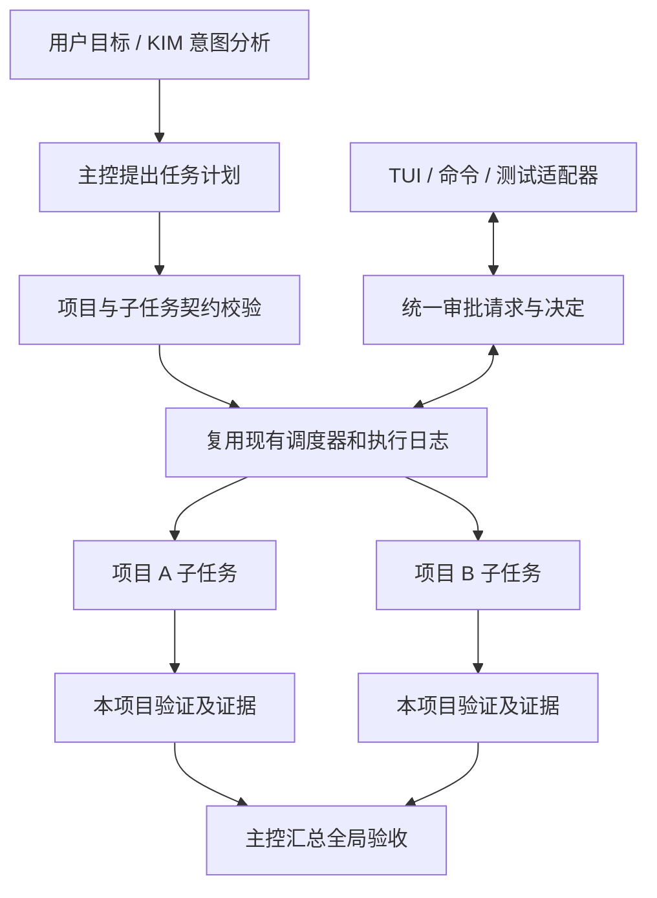

# 跨项目协作根因复核与修复方案

日期：2026-11-14；2026-11-15 更新。状态：R1–R4 已实施，详见 [R1 报告](r1-report-20261114.md)、[R2 报告](r2-report-20261114.md)、[R3 报告](r3-report-20261114.md)、[R4 报告](r4-report-20261114.md)。R5 本轮已执行巡检和修复，但未验收通过：收尾完整回归 344/344，最终同项目真实冒烟通过，跨项目在主控规划期限内未产出可派发计划，故未启动新版完整矩阵。阶段不能关闭，详见 [R5 报告](r5-report-20261115.md)。所有历史结果保留；下文根因分析保留方案制定时的证据，具体修复进展以阶段报告为准。

## 结论与历史结论更正

跨项目派发并不存在当前证据所证明的底层技术不可行问题。任务已经被派到不同项目、使用不同模型完成文件修改；不稳定主要发生在子任务边界、审批、审查与验证、失败恢复和测试判定的衔接处。DeepSeek Harness、Windows 或 TUI 不是本次已证实的根本限制。

上轮 matrix-9 仍保留原始 6/12 数字，但它不能直接代表产品真实能力的成功率。离线复核发现 deepseek-cross-2 的生产 coordination 已 completed，两个实施任务、两个 verify、两个 review 全部 succeeded。两个 notes.txt 内容正确且末尾 LF 正确，两个 verify.cjs 哈希保持基线。位于 other-project 的独立 verifier 实际在两个项目分别运行了精确验证命令，成功回执为 call_bc2828f6b75a4fa79cf183c6、call_1ece0e0298e64453b381b193。测试却要求有效回执必须出现在 t.cwd 等于被验项目的 verifier 中，遗漏了另一 verifier 在目标项目的有效执行。

因此，之前“缺少各项目原始验证命令回执”的概括不准确，应更正为“测试把审查任务目录当成命令实际执行目录，发生证据归属误判”。本次不据此把整轮改成通过，必须先修复判定器并重放旧证据。补充取证：artifacts/iteration-20261112-phase3e/matrix-9/root-cause-reassessment.json。

## 已证实的根因

| 根因 | 证据 | 后果 |
| --- | --- | --- |
| 子任务验收混入整个总任务要求 | 两个不同 project 的 task.contract.acceptance 都包含“两个目录均通过验证”等要求；task-admission.ts 继承上下文，auditTaskContract 再继承合同 | 两个审查者各自巡查两个项目，重复执行、重复审批、猜测兄弟目录，增加错误概率 |
| 项目与证据关联依赖自然语言和目录字符串 | orchestration.ts 的 acceptance 是字符串数组；master-team-live.ts:340 按 task.cwd 过滤实际命令回执 | 子任务责任不清，正确执行可能被测试误判；不能通过提示词可靠约束所有路径关系 |
| 低层文件核对被变成模型编写 Shell | 多次为字节数、换行、哈希、目录列表生成 PowerShell，并出现引号、管道与路径错误 | 已完成的业务修改被额外校验脚本拖慢甚至阻断；实际已有宿主字节证据，仍在重复证明 |
| 失败历史与当前是否完成混为一谈 | assurance.ts:417 要求 result.errors 为空；team-followthrough.ts:331、426 对错误/已有未通过 audit 直接阻塞 | 安全保守性正确，但“查询失败后纠正”与“未知写入副作用”缺少不同恢复规则 |
| 审批测试是人工参与的时序系统 | master-team-live.ts 只遍历 waiting_user，未知命令只接受 approved:true；最后 72 asked / 69 decided | 人工核查速度、终端焦点、缺少拒绝/取消等都会影响 600 秒结果，不能直接判定生产死锁 |
| 模型传输错误与总任务状态未充分衔接 | GLM 样本 Stream ended without finish_reason 后观察器等满 600 秒；另有模型服务 HTTP 500 | 没有进入派发也被统计为派发闭环失败；需要及时失败通知和安全的请求级恢复 |

不应把已有能力说成完全缺失：项目窗口匹配、任务租约/日志、范围检查、InteractionQueue 的 ID/version 校验、真实回执与产物版本核对都已存在。修复重点是统一这些能力之间的契约，而非再加一套调度器。

尚未证明的事项：未决审批是否包含生产队列竞争，需要直接事件重放才能判断；一次 completed 不代表稳定性；HTTP 500 的服务端原因不能靠本地代码推断。本次针对跨项目关键链路审查，不代表对全部 MCP/数据分析插件重新做过运行验收。

## 目标设计

主控把总目标形成计划；程序校验计划并绑定项目、执行会话和权限；工作代理只处理本项目子任务；验证器产出带项目和实际执行信息的回执；主控按全局依赖聚合结果。窗口只负责显示/操作，不承担事实身份。独立模式保持独立，只有用户指定主控并提交的协作目标才能纳入派发。

核心数据建议：

- ProjectRef：稳定 projectId、规范化真实根目录、版本。工作目录是属性，不能用可变窗口位置或文本标题代替身份。兼容无 Git 项目，处理 Windows 大小写、junction 和路径穿越。
- TaskContract：taskId、goalId、projectId、读写范围、输入引用、输出、依赖、localCriteria、verificationSpecs。全局要求留在 GoalContract.globalCriteria，通过子任务证据组合，不能直接复制到每个子任务。
- VerificationSpec：verificationId、projectId、argv 或明确的 shell 原文、cwd、输入版本、预期退出码与证据种类。命令从项目配置或计划提议产生后仍要权限检查；不能把模型生成的命令自动变成授权。
- ExecutionReceipt：taskId、runId、attemptId、projectId、callId、真实 cwd、实际程序/参数或 shell 文本、退出码、输出及输入版本。证据归属依据真实执行目标，不能只看产生回执的窗口。
- ApprovalRequest：贯通原生 approvalId 与 Interaction ID/version，关联 task/run/session/call、完整参数指纹和权限版本。允许、拒绝、取消、过期都进入明确终态；进程重启不复用旧批准。
- Failure：保留原始错误，另有分类、是否存在副作用不确定性、恢复尝试和 supersededBy。历史错误不直接等同于当前验收失败，也不能由模型一句“已恢复”清除。

这些是对现有 domain/application/adapters 的收敛方案，不是要求新建六个互不连接的服务。沿用现有存储、单一执行循环、任务租约与幂等机制；新增字段要版本化迁移，旧记录可读且不得伪造成功。

## 开源参考与适用边界

1. [OpenCode SubagentJob](https://github.com/anomalyco/opencode/blob/dev/packages/core/src/session/subagent-job.ts)：任务独立于发起插件的生命周期，恢复信息由 Job 持有，区分显式取消和服务关闭。采用任务身份与生命周期分离的思路，不照搬 Effect 技术栈。本地 opencode-dev.zip 版本还将完成通知作为独立模块，在线版本已有变化，落地前固定 commit。
2. [Codex App Server](https://raw.githubusercontent.com/openai/codex/main/codex-rs/app-server/README.md)：文档中的审批流程使用唯一 approvalId 和明确 accept/decline/cancel，客户端重新连接有待审重放机制。借鉴协议化响应；不要求 Emergence 引入远程服务器，进程内 application port 足够。
3. [Kimi Tower](https://www.kimi.com/code/docs/en/kimi-code-cli/guides/tower.html)：任务、工作代理、独立审查、持久化状态和事件通知值得参考；它主要服务单仓库 worktree，且工作代理与审查者采用 Never Ask，不能原样当成我们的跨项目审批解决方案。普通文件夹也要可用，不能为派活强制 git init/commit。
4. [LangGraph 故障恢复](https://docs.langchain.com/oss/python/langgraph/fault-tolerance)：按错误类型、有界退避和副作用身份恢复；确认丢失应作为 unknown，不能盲目重放。本项目借鉴设计，不另加 Python 图运行时。
5. [Claude Code 子代理](https://code.claude.com/docs/en/sub-agents)：上下文隔离、工具/权限边界、API 错误回传；只参考公开文档，不声称审查过闭源实现。

已阅读本地 Kimi 的 approval controller、subagent spawn，以及 OpenCode 的 job/completion 实现；这些证明有可借鉴工程模式，不证明其产品对任意跨项目工作都已无缺陷。

## 五个修复阶段

### R1：建立可信判定与最小失败重放

改动重点：tests/master-team-live.ts、fixtures/approval-events.ts、矩阵结果分析。建立只读离线证据校验器，把 planning、dispatch、execution、approval、verification、aggregation、transport 分开记录；命令证据从原生调用/结果及 host receipt 读取，不依赖“测试曾批准过的命令”映射。按实际 cwd 和项目归属校验，同时核对独立性、runId、输入版本，不能把任意成功 Shell 当成测试通过。

固定六类重放：全局验收污染、跨目录正确证据、两个并发审批、错误恢复、模型断流、错误项目路径。判定器既要接受有效证据，也要拒绝错误目录、篡改验证脚本、旧版本和伪造/他人回执。未形成协调记录的模型错误要立即终结测试，不能等待总观察时限。

验收：上述真实失败能在无付费模型环境中稳定重现；deepseek-cross-2 的证据归属缺陷有正负测试；历史矩阵不可修改，仅另出重评报告。本阶段不以扩大真实矩阵替代定位。

### R2：统一项目、子任务与验证契约

改动重点：domain/planning.ts、work-plan.ts、orchestration.ts；application/task-admission.ts、work-allocation.ts、assurance.ts 与证据适配器。

引入可校验的项目/验收项归属；每个工作代理只承担自己的 localCriteria。真正跨项目依赖单列为全局集成任务，读取允许的多个项目，或消费子任务产物/证据，不能让每个局部 verifier 重验整个总目标。原始总目标仅作背景，不授予跨项目权限。

复用宿主文件读取/版本能力提供哈希、编码、换行、目录清单证据。对纯确定性核验采用本地函数；需要执行的测试由统一验证入口按 VerificationSpec 运行并记录真实退出状态，避免要求模型不断手写 PowerShell。语义代码审查保留模型；确定性 verifier 与只读 reviewer 的职责明确，不能未经确认删除原有独立审查要求。

验收：A/B 各改一个文件，每个局部审查只核对自己的项目；真正集成任务有明确多项目授权；错误 projectId/越界 scope 在派发前拒绝；同项目/不同项目/无 Git/混合模型/独立窗口均覆盖。验证脚本修改、输入版本改变、用另一项目的成功回执代替均必须失败。

### R3：统一审批响应与跨窗口可观测性

改动重点：app/interactions.ts、controller.ts、工作台审批视图/投影及测试适配器。

复用现有 InteractionQueue 的 ID/version 机制，建立应用层审批索引和响应入口。TUI、命令和测试调用同一入口；pending 来自真实交互队列，而不是仅从 task.status 推断。原生请求与 UI 请求建立显式关联。保留窗口内审批，也允许主控集中查看待办，操作始终按请求归属和参数指纹处理，焦点切换不改变归属。

拒绝和取消必须把结果传回执行循环；旧请求、已结束 run、权限变更后的批准不能生效。只读元数据操作按已有权限评估，不用 Shell 白名单堆字符串变体；测试通过受限的进程内适配器驱动，无须新增对公网开放的控制接口。

验收：至少三个窗口并发，允许 A、拒绝 B、取消 C，各自得到准确结果；失焦、接管、关闭、模式改变和重启不串审；仍保留少量真实按键/鼠标 TUI 测试。拒绝后业务可明确失败或提出合规替代，不自动重新申请相同危险操作。

### R4：有边界的恢复与统一状态收敛

改动重点：team-followthrough.ts、assurance.ts、现有任务生命周期、预算与 provider 适配边界。先查依赖已有重试配置，避免上下两层叠加重试。

- 临时 429/5xx、无完整工具调用的断流：在原预算内有限请求级重试并带退避；默认建议最多 2 次额外尝试，最终失败明确回传主控。不可重试整个已产生副作用的业务任务。
- 查询/校验语法错误：在确认操作可安全重复且无未知副作用时允许新 attempt，成功证据可显式替代对应失败观察，保留历史记录。
- 真实测试不通过：作为产品缺陷进入有界修复，不因重新跑到绿色就无条件覆盖。
- 写入/命令副作用不确定、进程中断：先核对实际产物与执行日志，不能假设未执行，更不能重放未知操作。
- 用户拒绝/取消：终止或暂停对应任务，不自动绕过，不扩大权限。

运行、排队、等待用户、模型请求分别计时并保留总期限；等待审批不消耗执行时间的规则需显式定义，但人工等待仍有独立上限，不能无限续命。所有可达状态必须有后续事件或终结条件。

验收：500 后成功、断流、只读检查恢复、真正的测试失败、取消、写后失联、重启逐一故障注入；没有重复写入、旧批准复用、无限重试或主控永久 busy。最终结论依据有效证据与未解决失败，而非 errors.length 简单归零。

### R5：集成与真实矩阵验收

先跑确定性集成（真实调度器/存储/权限/验证器，模型端可控）和 TUI 操作，再各做一个真实同项目/跨项目冒烟；失败返回所属 R1–R4 修复并重新固定构建。入口和判定稳定后，才运行原 12 项完整矩阵。

完整覆盖：独立会话；同项目；跨项目；相同/不同模型；任务依赖；并发审批的允许/拒绝/取消；工作窗口占用；进程重启；工作代理失败；未知副作用。每次失败自动保留阶段、项目、task/run/approval ID、最后有效回执及等待原因，不能只给一个 FAIL。

关闭标准：确定性边界测试全过；完整 12 项在同一冻结构建全过；另行覆盖的故障场景符合预期且无副作用重放；人工实际使用能一次下达总目标、仅在权限需要时响应、得到准确汇总。外部 API 失败如实记录，本轮不算全通过；只有外部条件确已恢复或代码改变才能有理由新开一轮，不能循环刷到绿色。性能、请求数、tokens 和审批等待单列，不能仅用成功率掩盖成本。

## 避免继续耗时与堆补丁的执行规则

- 每阶段先列出不变量、最小失败用例和退出门槛，再实施；阶段报告必须对应行为证据，测试数量不等于闭环可靠性。
- R1–R4 不反复跑 12 项真实矩阵；优先离线重放和故障注入，只对新变化做必要验证。
- 不新增第二个调度器、第二套审批许可或第二个事实存储；不靠命令特例、超时加长、禁止所有外部 Skill 或强制免审批求通过。
- 一个事实一个来源：项目由注册表、执行由任务日志、权限由现有策略、审批由交互队列、成功由当前有效回执决定。
- 类型/契约升级与调用方在同一阶段迁移，兼容适配只留在边界且标明移除条件；原路径替换后删除重复实现。
- 保留 Emergence 品牌、KIM 分析/治理、多窗口独立使用和现有 TUI 设计；本次修复只触及协作链路的职责与必要审批接入。
- 方案不承诺模型永不出错。要求程序能够准确派发、限制影响、显示真实状态、进行安全恢复，并在无法完成时给出可操作原因。
