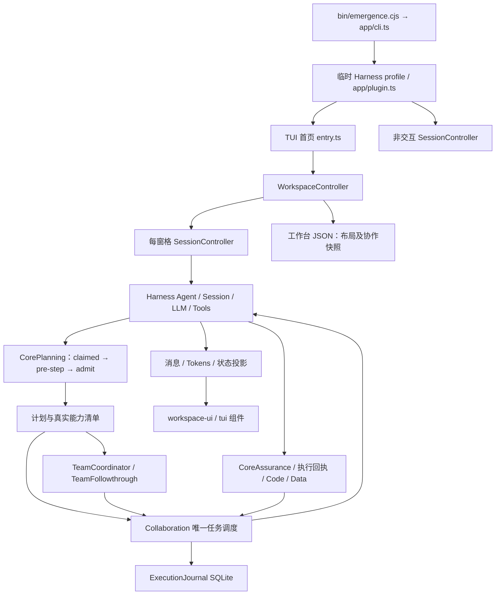
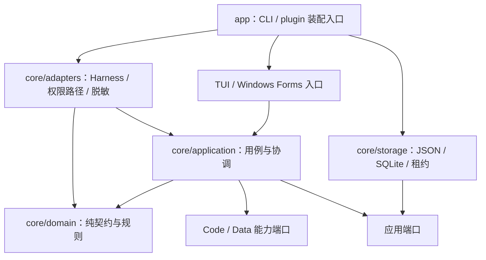

# 第一阶段：当前结构、状态归属与目标架构

日期：2026-11-08。对应本轮六阶段优化，不替代历史开发报告。本文的“当前”来自源码核对；“目标”属于第二阶段迁移设计，尚未实现。

## 1. 当前运行链路

| 运行路径 | 已核对的入口与责任 | 必须保持的行为 |
| --- | --- | --- |
| 启动 | `bin/emergence.cjs` → `app/cli.ts` 解析配置/凭据、生成 profile → `app/plugin.ts` 装配和资源释放 | `emergence` 命令、配置目录、首页首次提交流程保留；不另造 Harness 执行循环 |
| 普通输入 | `WorkspaceController.send/dispatch` → `SessionController.send` → `agent.followup` → `CorePlanning.mount` | 已领取消息才进入正式准入；尚在 inbox 的追问不能覆盖正在执行的目标 |
| KIM | `core/assets/catalog.ts` → `loadCoreCatalog` 校验 hash/schema；`CorePlanning` 做原生准入、分析/计划工具与 turn-stopping 自动执行；observer 单独负责观测 | KIM 原生治理与外部 Skills 不是同一入口；简单任务允许轻量路径。catalog 中的上游依赖声明不等于已连通外部服务 |
| 主控窗口 | `WorkspaceController.setMaster` → `Collaboration.configure`；`TeamCoordinator` 汇总实际窗口、模型、权限和负载 | 独立模式和主控模式明确区分；角色偏好不是权限授权；窗口忙于独立工作时不能抢占 |
| 派工 | `CorePlanning.submit/run` → work/task-allocation、task-admission → `Collaboration.executePlan/enqueue/pump/start` | 一个任务队列；先验证绑定、权限、容量和持久化再执行；保留原始约束及验收 |
| 审查与汇总 | `CoreAssurance`、execution/tool/native-read-evidence → `Collaboration.finish/review` → `TeamFollowthrough.advance/reconcile` | 回执来自真实工具；产物版本变化使旧审查失效；模型报告不能独立授予成功状态 |
| 取消/恢复 | workspace.cancelFocused → followthrough.cancel / collaboration.cancel → SessionController.cancel；启动 journal.load + collaboration.load | 等待 Harness idle 后报告停止；重启暂停，不重放未知副作用；过期租约不能写回 |
| 编程 | SessionController 注册 `CodeUnderstanding`/`CodeWorkHarness` 相关工具 → `domains/code` 项目发现、检查、workflow | 检查前后标准一致；用户已有修改受保护；Git 可选，不把非仓库当成应用无法运行 |
| 数据 | SessionController 注册 `DataFoundation` → data/service → 固定 Python worker/analytics → manifest、result、delivery | 原始输入不覆盖；SQL 和执行环境限制保留；现有发行包资源缺口属于第五阶段 |
| Skills / MCP / 扩展 | Harness skills 服务；`Capabilities` 管理 MCP fiber；`Extensions` 显式启用宿主 JS | 真实可调用能力才进入清单；断开后释放工具。JS 扩展是受信任代码，不是权限沙箱 |
| 原生模型配置 | CLI 或 plugin → model-config 回环服务 → Windows Forms；model-configuration/runtime 更新配置和实时路由 | 不引入 WebView；DPAPI、认证令牌、变更串行与 busy 检查保留 |

非交互 `--print` 直接装配 SessionController，不经过 WorkspaceController；重构端口必须覆盖这条路径。测试中使用模拟供应商的真实 Harness 调用不等于真实远端 API 验收。

## 2. 状态所有权与恢复顺序

`H` 表示用户配置目录，默认用户主目录下 `.emergence`，不记录作者个人绝对路径。

| 状态 | 当前写入者 / 读取者 | 持久化与恢复 | 目标归属与禁止事项 |
| --- | --- | --- | --- |
| 会话历史、模型消息 | Harness Agent/Session；Controller 和消息投影读取 | Harness sessionPersistence | 仍由 Harness 管理；TUI 不能自造历史或完成事件 |
| 窗格、焦点、草稿、布局、模型绑定 | WorkspaceController；UI、配置 host 读取 | `H/workspaces/<项目哈希>.json`，version 1 | Workspace 管布局，Session 管有效会话；切焦点不能改变审批归属 |
| 任务图与状态 | Collaboration 为主；budget/assurance/followthrough 等合作组件亦能修改任务记录 | `H/core/execution/<项目哈希>.sqlite`，user_version 1；工作台 JSON 还保留协作快照 | TaskLifecycle 统一写入规则；同一图不能存在两个调度器或以 UI 快照覆盖台账 |
| 执行租约、fence、effects | ExecutionJournal 与 Collaboration 的执行钩子 | SQLite ownership/tasks/effects/events，事务提交 | Journal 只管持久化和归属校验；不可自行授予业务成功 |
| 规划/意图 | CorePlanning 每 Agent 状态；TeamCoordinator 接收规划变化 | PlanStore：`H/core/plans/<scope>.json`，version 1 | PlanningService 管请求分析与计划；计划不是可重放执行日志 |
| 总任务协调阶段 | TeamCoordinator.sync、TeamFollowthrough | collaboration.coordinations，随 journal checkpoint | TeamCoordinator 管接收、Followthrough 管后续推进，通过同一生命周期入口提交变更；不得各自建任务队列 |
| 有效权限 | SessionController revision、app/permissions、角色/任务快照和 local-policy | 配置和任务快照持久；临时授权绑定当前请求/会话 | 纯权限规则与路径适配分离；变更使旧审批失效；角色菜单不能扩大权限 |
| 待审批/问题 | 每 Controller 的 InteractionQueue | 当前进程内，以 request ID/version/session/agent 定位 | 不恢复旧批准 Promise；重启后需重新核对授权，焦点不决定所属人 |
| 工具回执与审查结论 | Collaboration/CoreAssurance 执行钩子、Code/Data 工具附加证据 | task.receipts、assessment、artifactVersions；effect journal | EvidenceCollector 记录事实，AssuranceService 判断；任何晚到回执不能复活取消任务 |
| 记忆 | CoreMemory → MemoryStore | `H/core/memory/records.json`，version 1；租约锁 | 保留 candidate/approved/forgotten、项目/会话隔离和遗忘 tombstone；不得自动扩大到个人共享 |
| 核心观测 | CoreObserver → FileObservationStore | `H/core/observations` 下观测快照，schemaVersion 1 | 只观测，不能作为恢复任务或授权执行依据 |
| Code 检查与证据 | CodeWorkflow | `H/core/code-runs`，schemaVersion 1 | 由 Code 领域维护；基线、检查配置、产物版本关联，不能更换标准后沿用通过 |
| Data 口径与运行产物 | Definitions / data service/delivery | `H/core/data-definitions` 项目绑定口径记录；`H/core/data-runs/<run>`；schemaVersion 1 的成功清单 | 数据口径有用户确认与版本；执行输出保留失败状态，不以报告存在判断成功 |
| 模型配置/凭据 | config update/migrate、ModelConfigurationService、credentials | `H/config.json` version 1；DPAPI 凭据文件 | 统一配置写入与 revision 冲突检查；凭据不得进入任务图/公开样本 |
| UI 派生状态 | message-model/session-usage、workspace UI | 大部分内存；草稿随布局保存 | 只负责显示；缺失 Tokens 回执不得当作零 |

**已确认的恢复优先级：** Collaboration.initializeJournal 先读取 SQLite；load 使用 `journalSaved ?? legacyJSON`。只有没有台账快照时才导入历史 JSON；导入前备份。恢复非终态任务为 interrupted，恢复工作台为 independent + paused；effects 决定是否 uncertain。台账有任务而布局缺失时明确阻止隐式恢复；`--fresh` 是显式归档后重建。

本阶段新增回归专门制造“布局 JSON 声称成功，但 SQLite 仍待审查”的冲突，确认不会错误完成，同时保留布局草稿且不重放工具。既有 hard-crash/fence/legacy 测试继续保留。

## 3. 静态依赖与目标模块

本轮静态盘点：109 个自有 TS/TSX/Python 源文件，13398 行；AST 提取 568 条静态字面导入/导出/动态 import。23 条 `core → app` 边，其中运行导入 15、纯类型 8。此统计不覆盖计算型动态 import 和事件依赖；并不把所有类型边描述成运行循环。

目标采用现有工程内的分层，不增加服务进程、第二套执行引擎或通用事件总线：

文件命名为第二阶段指定落点；如实际提取表明两个职责无需拆分，可合并实现，但不得改变责任或保留重复业务分支：

| 当前集中点 | 目标落点 | 接口边界 |
| --- | --- | --- |
| app/permissions + orchestration + task-state | `core/domain/permissions.ts`、`orchestration.ts`、`task.ts`；路径解析在 `core/adapters/permission-path.ts` | schema/纯判定不读文件系统；主机路径事实在适配层取得；中文标签留展示边界 |
| app/config 的 safeError、credentialNames | `core/adapters/redaction.ts`；纯内容规则在 domain | 环境密钥枚举属于适配层；memory 内容校验保留敏感检测，不能只移动 import 就把环境访问带进 domain |
| app/lease | `core/storage/lease.ts` | 保留操作系统租约与真实路径语义；应用只使用释放接口 |
| Collaboration 队列/状态 | `core/application/task-lifecycle.ts`、`task-scheduler.ts` | Lifecycle 负责状态/准入/结算，Scheduler 只推进唯一队列；Journal 通过执行存储端口注入 |
| Collaboration 工具/钩子 | `core/adapters/collaboration-tools.ts`、`task-execution.ts` | 工具解码调用用例；Harness 钩子提供真实事件，不能直接散写任务状态 |
| Collaboration 证据/恢复 | 复用 application 的 execution-evidence/assurance；新增 `task-recovery.ts` | 证据收集与恢复决策分开；恢复复用任务准入与新尝试，禁止旁路重放 |
| CorePlanning | `core/application/planning-service.ts`；现有 planning adapter 留注册/事件转换 | 分析、准入、计划持久化归应用；context renderer 只消费快照；不建立第二套 KIM 状态 |
| core/application 对整个 Collaboration/Workspace 的依赖 | 扩展 `core/application/ports.ts`，按实际消费者给 TaskAccess、WindowInventory、TaskDispatch 等小接口 | 只暴露查询与明确用例，不提供任意 mutable task/controller 引用 |
| Workspace/UI 命令分散 | Workspace 仍管窗口；Settings/commands 统一注册描述和用例调用 | 快捷键、菜单、斜杠入口触发相同用例；不把渲染器塞进核心 |
| JSON 文件重复实现 | `core/storage/safe-json-file.ts`，仅有界读取/原子替换/路径检查 | schema、锁、容量与损坏处理仍由各 Store 决定，不做吞异常的万能 repository |

## 4. 架构决策记录

- **ADR-01 单一执行事实源：** SQLite 对任务与 effects 权威；布局 JSON 管窗格。先保留 v1 兼容快照，禁止双向合并推断“较新成功”。后续去除重复快照需单独迁移，不在拆模块时顺便改磁盘格式。
- **ADR-02 核心依赖方向：** 领域只依赖纯规则/契约；应用依赖端口；存储/主机/Harness 适配实现端口。通过接口收缩现有服务，不引入依赖注入框架。验收不仅查 import，还核查运行事件注册和释放。
- **ADR-03 治理与执行分工：** KIM 负责意图、计划和治理，Harness 负责执行循环；Emergence 负责权限、调度、证据和完成判定。保留轻量请求路径和外部 Skills 能力发现。
- **ADR-04 重构期间行为不变：** 第二阶段以职责迁移为主；工具参数结构化、自动派工/失败策略集中第三阶段。结构修改与行为修改分批提交，以便回归和回退。
- **ADR-05 同步与异步边界：** 状态转换必须经过唯一入口；依赖权限、目录、文件或窗口事实的异步操作，返回时重验版本/归属。UI 和模型无法直接提交成功状态。
- **ADR-06 有限兼容：** 仅为当前有消费者的旧入口保留转换层；登记调用者与退出条件。禁止新旧调度器并行、永久双写或全局 util 堆积。

迁移批次、兼容策略和测试映射见 [迁移与验收清单](phase1-migration.md)。
