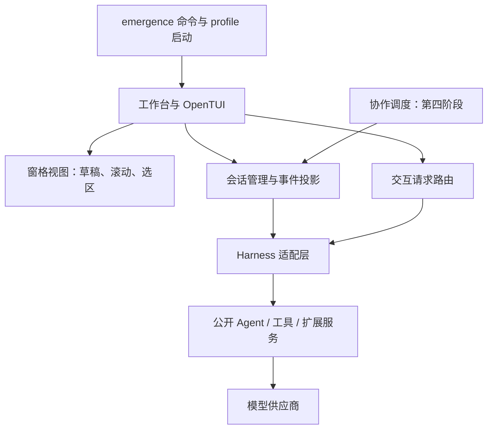

# 阶段一架构决策

日期：2026-10-29。适用范围：首版工程起点；扩展到更多系统能力后重新核验兼容性。

## 已选组合

| 层 | 决定 | 验证与取舍 |
| --- | --- | --- |
| 应用 | 独立 TypeScript 工程 `emergence/` | 与参考源码分开，未修改原始压缩包和参考源码 |
| UI | OpenTUI core 0.7.0 | Node 和 Bun 下原生渲染测试通过；使用其编辑器、滚动与焦点能力 |
| 运行时 | Node 26.4.0 + `--experimental-ffi` | 项目内安装，不修改系统 Node；FFI 仍为实验功能，发行包需固定版本并复测 |
| Harness | 0.2.2-alpha.2 的公开 Agent/Registry/插件接口 | 实际执行循环已验证取消、工具取消、独立路由、队列、释放 |
| 框架 | Cordis 4.0.6-alpha.1 | 与 Harness peer 版本一致，统一由拥有者释放插件效应 |
| 输入/布局 | 先使用 OpenTUI 原生组件 | 本阶段不引入 React UI 适配成本；React 仅用于 dsh-TUI 对照原型 |

OpenTUI 在 Bun 1.4.4 下也通过对照验证。采用 Node 是为了与 Harness 的 Node 应用环境保持一致。当前验证使用最小插件组合；完整 profile、shell、持久化、浏览器和原生附加模块仍需在第二阶段逐项运行。

## Harness 接入

SDK 子进程接口缺少轮次取消和会话关闭，不能覆盖所需交互。改用公开的 `ctx.agents.create()` 获取 AgentHandle，发送 `followup()`，观察 `agent/status` 和 `agent/assistant-stream`，调用 `agent.cancel()` 中止当前工作，通过 `handle.dispose()` 释放指定会话，最终释放 Cordis 根 fiber。

阶段一为库级运行时验证。第二阶段产品启动遵循上游 `dsh` profile 的应用启动约定，在自有 profile/plugin 中挂载涌现；不把本轮测试用手工插件组装当成完整产品启动器。启动参数到 profile 的转译集中在入口，能力实现集中在适配层。

取消必须等待 Agent 回到 idle 后才反馈为已停止。取消依赖模型流和工具合作响应 AbortSignal；不能据本次合作式工具测试承诺可强制终止任意不响应信号的代码。

## 模块关系

项目 workspace、会话 session、窗格 pane、工作 task 分别拥有稳定 ID。事件由会话 ID 路由，临时交互额外携带 request ID。窗格的焦点不参与决定请求归属。

真实历史由 Harness 持有，UI 只投影已有事件；暂存的流式内容在持久消息结算后对齐。关闭视图与释放 Agent 是不同操作。工作目录从会话的有效目录服务读取，不能一直使用进程 cwd 或创建时 header。

## 渲染候选比较

两组原型使用相同的 60 条混合宽度文本与 50 轮受控事件，覆盖 2/4 窗格。dsh-TUI 对照直接编译用户压缩包内的原渲染源码，未替换为普通 Ink npm 包。

| 项目 | dsh-TUI renderer 原型 | OpenTUI 原型 |
| --- | --- | --- |
| 双/四区域显示 | 模拟 TTY 通过 | 原生无头渲染通过 |
| 中文、emoji、粘贴与焦点 | 模拟 TTY 通过；ConPTY 宽屏通过 | 无头与 ConPTY 通过 |
| 独立滚动 | 最小对照界面未实现，未计为通过 | 原生 ScrollBox 测试通过 |
| 50 列窄屏恢复 | 系统 ConPTY 初测异常；改用 node-pty 附带 ConPTY DLL 后复测通过 | 系统和 DLL 两类 ConPTY 均通过 |
| Ctrl+C、备用屏退出 | 已验证 | 已验证 |
| 分发代价 | 需要维护较大的上游定制渲染依赖 | 需原生平台包及 Node FFI/Bun |

最终两种渲染器都能通过基本输入和退出检查，选择 OpenTUI 的主要理由是其现成编辑器/滚动组件、较小的宿主定制范围。初测异常仍提示终端实现会影响显示，不能将它认定为 dsh-TUI 正式产品的通用缺陷。两组最小组件完整度不同，记录的耗时不能用作性能排名。

## 保留的边界

- 第一版退出应用停止其持有的运行时；后台服务不隐含在当前架构承诺中。
- 多模型复用 Harness pi-ai/供应商适配，涌现不另写一套模型协议。
- 同目录多任务先提供可见协调与可选 worktree；不宣称所有工具都有文件锁。
- 主控以结构化任务 API 派发，不能靠往屏幕输入文字判断任务成功。
- 每次更新 Harness/OpenTUI，重跑取消、路由、粘贴、缩放和退出回归。
