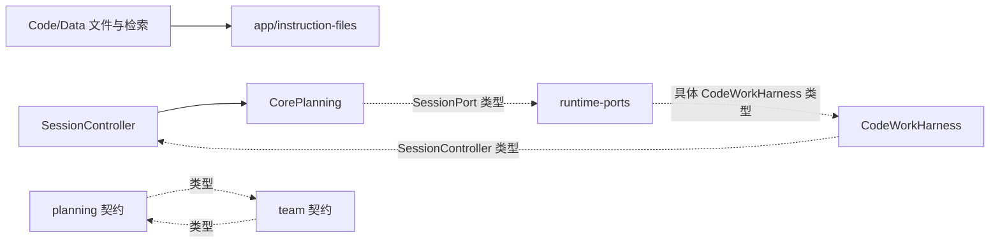

# 第一阶段职责、状态与依赖

这是 1.00 当前实现的盘点。标注“目标”的部分是后续整改要求，不表示已经完成拆分。

## 模块职责

文件级清单见 [module-inventory.json](module-inventory.json)：覆盖 `src` 下全部 156 个 TS/Python 源文件和原生 C# 入口，共 157 项。分类采用保守归属，混合文件的成员级去向以 [退役清单](retirement.md) 为准。生成数据属于冻结基线，不是每次修改都要手工维护的第二份运行配置。

| 编号 | 当前模块 | 职责与后续边界 |
| --- | --- | --- |
| M01 | CLI、plugin、SessionController、运行身份与诊断入口 | 组装 Harness 和会话；Controller 当前还持有审批和显示职责，第四阶段分离；非交互 `--print` 也使用本组装链 |
| M02 | WorkspaceController、工作台命令、布局配置、模板 | 管理独立窗口、绑定、焦点、草稿和布局存储；当前同时连接共享任务引擎及退役 team 对象，第三阶段收敛 |
| M03 | workspace-ui、interaction-ui、tui、layout、terminal-actions | 展示和输入路由；只通过操作请求改变业务状态，显示缓存不能成为执行真相 |
| M04 | core/domain | 纯规则、schema、权限/规划/任务/证据契约；当前 planning/team 类型形成循环，第二阶段处理 |
| M05 | planning-service、planning-drafts、准入与分配辅助 | 拥有需求分析与计划上下文，检查计划是否可执行；不拥有工具执行循环；历史分配分支按成员拆分 |
| M06 | task-coordinator、lifecycle、scheduler、budgets、recovery、assurance、证据与验证 | 单一任务状态和执行准入、证据核对、取消/恢复；保留共享职责，移出跨窗口控制和分配审查的专属部分 |
| M07 | team-coordinator、team-followthrough、coordinator-context | 退役主控编排相关；当前仍存在调用及历史字段联系，不能整组直接删除 |
| M08 | core/storage | 租约、事务台账、文件保存、历史版本解码；不决定用户授权或业务成功 |
| M09 | domains/code | 源码检索、检查发现、修改基线与验证回执；不拥有全局计划或用户权限 |
| M10 | domains/data | 固定数据运行环境、worker/analytics/probe、口径、结果与交付物；不覆盖原始输入 |
| M11 | config、credentials、settings、model-*、原生 Program.cs | 配置/密钥更新、模型路由与 Windows Forms；原生草稿是未保存副本，不是配置真相 |
| M12 | capabilities、extensions | MCP 连接和显式启用的扩展生命周期；计算型模块导入在此边界发生 |
| M13 | instruction-files、instructions、instruction-init | 规则发现、作用域和上下文；其中通用路径/文件工具在第二阶段下沉 |
| M14 | core/adapters、observer、核心目录资产 | 将 Harness 钩子/工具对接到业务能力，维护观测、记忆等流程；第三方和生成资产继续按来源校验 |

## 依赖事实

- 156 个 TS/Python 源文件、28,073 行；TS 语法依赖共 857 条，包含外部包导入。
- `core → app` 的直接导入为 0，但这不足以证明能力与应用层已经隔离。
- `domains → app` 有 8 条边：3 条引用具体 Controller 的类型边，5 条复用 instruction-files 的值导入。
- `core/application/runtime-ports.ts → domains/code/work-harness.ts` 有 1 条具体类型依赖。
- 值导入图没有循环；加入类型边后出现 2 个强连通组：一个包含 33 个模块，另一个为 `core/domain/planning.ts` 与 `core/domain/team.ts`。
- 计算型导入 1 处：`app/extensions.ts` 按已启用配置加载模块。
- 标出了 202 处事件、工具/上下文注册或定时器语法位置。位置数量不等于活跃监听器数量，也不能证明它们都已正确释放。

巡检按语法区分 `type` 导入，值边是编译器消除类型前的保守近似。Python/C# 的内部依赖以及实际事件触发不由 TS 图证明；下面列出人工核对的关键连接。

当前类型耦合的代表性路径：

第二阶段目标是切断具体实现类型的反向联系，并将底层文件工具移到职责正确的位置；第四阶段再拆分大类内部职责。不能仅将同一整套 Controller 成员复制到一个巨大接口中。

## 状态归属

`H` 表示用户配置目录。以下是当前写入责任与读取路径，不表示所有公开可变字段已在类型系统中封死。

| 状态 | 当前权威写入入口 | 读取者与存储/恢复 | 后续约束 |
| --- | --- | --- | --- |
| 会话消息、Agent 状态、工具执行 | Harness Agent/Session/执行循环；Controller 发送或取消请求 | 消息投影、规划观察、Code/Data 证据；Harness session persistence | 保持 Harness 唯一所有者，不通过 UI 合成完成事件 |
| 窗口绑定、布局、焦点、草稿 | WorkspaceController 与其命令/模型配置操作；UI 写草稿和滚动位置 | `H/workspaces/<project>.json`；UI、配置 host 读取 | 第二/五阶段区分持久布局、草稿和仅内存的视图状态，保留单一保存入口 |
| 会话句柄、切换、关闭与子代理归属 | SessionController.open/send/cancel/close，Harness 所属关系 | 工作台、诊断、权限和显示 | 子代理归属不能等同于其他窗口控制；第四阶段统一资源释放责任 |
| 审批/提问队列 | 每 Controller 的 InteractionQueue.request/answer/cancel* | interaction-ui、WorkspaceInteractions 投影；仅内存 | 响应须核对 ID/version/会话/参数/权限；重启不恢复旧授权 Promise |
| 有效权限、临时授权与拒绝记录 | Controller 权限切换、permissionGuard、审批回调；任务约束参与判定 | permission snapshot、运行中的工具；临时 grants/declined 不持久化 | 配置、角色、UI 焦点不能扩大任务权限；旧审批在权限变化后失效 |
| 需求与规划状态、草稿、上下文 | CorePlanning 和 PlanningDrafts，经其已安装工具与事件操作 | `H/core/plans/<scope>.json`，当前 schema v2；模型上下文与计划描述 | PlanStore 解码 v1 为 blocked，不自动执行；拆分后仍保留一个权威计划对象 |
| 任务元数据、状态、计时及回执数组 | TaskLifecycle.amend/transition/append；Coordinator 等通过该入口操作 | ExecutionJournal SQLite；工作台任务视图、预算/恢复 | 任务状态只走生命周期；Coordinator 的 active/admitting/提交去重集合仍有明确单一所有者 |
| 执行归属、fence、effect 开始/返回/未知 | ExecutionJournal 与 TaskExecution 钩子 | `H/core/execution/*.sqlite`；恢复检查读取 | 未确认副作用不自动重放；SQLite 真相优先于旧布局快照 |
| 验证结果、报告与产物版本 | 工具证据采集、CoreAssurance、verification，经生命周期保存任务证据 | 任务回执、文件版本、记忆准入 | 保留真实证据核对；跨窗审查分配部分独立退役 |
| 旧主控记录和 followthrough | 当前对象仍接收空操作/兼容调用；历史记录在旧 schema 中存在 | `coordinations` 等台账字段；Team 对象、历史视图 | 第三阶段分离历史读取；清除活动 master/workers 不等于可以删除全部数据字段 |
| 记忆候选、批准、遗忘 | CoreMemory → MemoryStore，操作遵循权限与证据 | `H/core/memory/records.json`；项目/会话检索、遗忘标记 | 不自动扩大为跨项目共享；保留审批与 tombstone |
| 观测记录 | CoreObserver → ObservationStore | `H/core/observations`；KIM 状态/诊断 | 观测记录不能授权工具或重启任务 |
| Code 修改基线与检查状态 | CodeWorkflow.begin/beforeEdit/afterEdit/beforeCheck/afterCheck | `H/core/code-runs`；工具响应、任务验收 | 当前源文件、检查配置、成功回执共同决定有效性；重启需重新验证 |
| Data 定义、运行、结果和交付 | Definitions、data service/delivery；Python worker/analytics 产出结果 | `H/core/data-definitions`、`H/core/data-runs`、manifest | 原始输入不覆盖；定义确认、失败/超时及产物哈希保留 |
| 模型配置、密钥、路由 | config 更新/迁移、ModelConfigurationService、credentials、runtime host | `H/config.json`、DPAPI、进程内解析；C# 为客户界面 | 串行更新/revision、运行中窗口可变性检查及密钥不落明文保持 |
| MCP/扩展实例、工具与连接 | Capabilities 的 fiber、Extensions 的 active/dispose/jobs | 工具清单、配置及诊断；实例内存 | 禁用/关闭卸载工具并等待收尾；扩展是显式信任代码，不假称沙箱 |
| 消息投影、Tokens、编辑器和菜单状态 | MessageProjection、SessionUsage、各 TUI 组件 | 界面内存，部分草稿由工作台保存 | 投影不是业务真相；未返回 Tokens 保持“未返回”，不能伪装成零 |
| 运行预算、停止原因 | RunDiagnostics、TaskBudgetMonitor、规划预算处理 | 诊断 store、会话状态、任务 timing | 区分排队/审批/执行/暂停；超时停止与关闭有归属，不另建重试循环 |

## 动态连接与资源收尾

| 入口 | 已核对的连接 | 收尾责任与重构注意 |
| --- | --- | --- |
| SessionController 构造与 open | 安装 KIM 观察、规划、记忆、Code/Data、规则上下文；订阅 Agent/tool/approval/questions；已存在 Agent 显式 register | disposers、AgentHandle、子代理租约、planning.settle、core/diagnostics.close 参与关闭；拆分必须同步迁移注册与注销，不能重复安装 |
| WorkspaceController.attach | 连接 planning.onExecute、onIntake、environment、approvalScope、permissionConstraints 与记忆证据 | 当前 onIntake/roster 仍引用 TeamCoordinator；迁移时保留本窗口权限/证据约束，不把关闭协同等同于移除这些约束 |
| Collaboration/TaskExecution | 接入 tools 执行、原生 turn/step 回执、任务预算、调度与 effect journal | close 取消并等待执行收尾；任务生命周期与 Journal 不得被多个新模块各持一份副本 |
| workspace-ui | 注册 workspace、renderer、keypress/paste、frame 及状态定时器 | UI dispose 移除订阅与 timer；分组件后每个组件拥有自己的释放函数 |
| Extensions.activate | 经配置模块 URL 动态 import，注册工具/命令/面板并收集 cleanup | 显式启用与权限边界保留；关闭按 active 的 dispose/jobs 收尾。静态图不能枚举用户扩展实现 |
| Capabilities | MCP fiber 连接、ready、断开与能力清单 | 初始化失败/禁用/关闭经同一 fiber 释放，不能仅从 UI 列表移除 |
| 模型配置服务与 Program.cs | CLI/plugin 启动本机服务，C# attach 或隐藏启动后端；轮询与请求绑定服务会话 | C# Connection.Dispose、管道结束及服务关闭各有职责；credential resolver 的恢复只撤销自己安装的包装 |
| 数据运行 | TS 调用固定 Python worker；worker/analytics/probe 与锁定运行资源连接 | 取消/超时、进程退出与临时结果归运行层；数据报告不自行认定进程成功 |

第一阶段只确认连接和归属，没有声称以上大类已被拆分，也没有把静态循环计数当成资源泄漏检测结果。
